# Estado del TP2 — Docking molecular sobre SIRT1

Diseño & Descubrimiento de Drogas, FI-UNER 2026. Grupo: Lucas + Juliana. Compuesto de trabajo: **Mepenzolato (ZINC03813083)**.

---

## 1. Pipeline completo, con estado actual

```mermaid
flowchart TD
    A["TP1: Cribado virtual<br/>1738 ligandos vs SIRT1"] --> B["4 mejores hits<br/>(score Vina -11.1 a -11.2)"]
    B --> C["TP2-a: Complejos + LigPlot<br/>(receptor correcto: SIR1_lista.pdb)"]
    C --> D["Identidad confirmada (ZINC):<br/>Darifenacina, Fexofenadina,<br/>Solifenacina, Mepenzolato"]
    D --> E["Elección: Mepenzolato<br/>(menor PM, mejor logP)"]
    E --> F["Análisis interacciones:<br/>H-bond O3-Tyr49 2.49 Å<br/>+ red hidrofóbica"]
    F --> G["Modificación 1:<br/>N+ cuaternario → N-H+<br/>(metilo C17 → H, hacia Ser210)"]
    G --> H["GaussView:<br/>compuesto1_AA.pdb"]
    H --> I["TP2-b: Opt. DFT<br/>B3LYP/6-311G"]
    I --> J["Single point RESP<br/>(.gesp)"]
    J --> K["Antechamber → .mol2"]
    K --> L["ADT: ligando → pdbqt"]
    L --> M["Grilla AutoGrid4<br/>sobre SIRT_close_dock.pdbqt"]
    M --> N{"Docking AutoDock4<br/>(GA, pob. 1500)"}
    N --> O["Análisis: clusters,<br/>energías, H-bonds"]
    O --> P["Complejo final + LigPlot"]
    P --> Q["Docking con Vina<br/>+ comparación AD4 vs Vina"]
    Q --> R["Preguntas de análisis final<br/>(a, b, c, d)"]
    R --> S["Informe"]

    style A fill:#d4edda
    style B fill:#d4edda
    style C fill:#d4edda
    style D fill:#d4edda
    style E fill:#d4edda
    style F fill:#d4edda
    style G fill:#d4edda
    style H fill:#d4edda
    style I fill:#d4edda
    style J fill:#d4edda
    style K fill:#d4edda
    style L fill:#d4edda
    style M fill:#d4edda
    style N fill:#fff3cd
    style O fill:#f8d7da
    style P fill:#f8d7da
    style Q fill:#f8d7da
    style R fill:#f8d7da
    style S fill:#f8d7da
```

🟢 Hecho | 🟡 Próximo paso | 🔴 Pendiente

---

## 2. Decisión clave sobre el receptor

Hubo un error temprano importante: armar los complejos de LigPlot con `SIRT_close_dock.pdb` daba 0-8 átomos de contacto (receptor equivocado). Se confirmó por script de distancias que **las poses del cribado oficial corresponden a `SIR1_lista.pdb`** (91-111 átomos de proteína a \<4 Å). Ese es el receptor correcto para los complejos de interacción (LigPlot, TP2-a).

⚠ Para el **docking nuevo (TP2-b)**, la guía pide explícitamente `SIRT_close_dock.pdbqt` — es un marco de coordenadas distinto al de `SIR1_lista.pdb`. Ya se usó correctamente para la grilla.

---

## 3. Los 4 compuestos: identidad y propiedades confirmadas

| ZINC ID | Nombre | Actividad real | PM (Da) | LogP | HBD | HBA | Rot. | Anillos | PSA (Ų) |
| --- | --- | --- | --- | --- | --- | --- | --- | --- | --- |
| 01996117 | Darifenacina | Antag. M3 | 426.55 | 3.96–4.67 | 1 | 3 | 7 | 4 | 55.6 |
| 03872566 | Fexofenadina | Antihist. H1 | 501.66 | 3.0–4.6 | 3 | 5 | 10 | 4 | 81.0 |
| 03936683 | Solifenacina | Antag. M3 | 362.47 | 3.86–3.99 | 0 | 3 | 2 | 4 | 32.8 |
| **03813083** | **Mepenzolato** | **Antag. M2/M3** | **340.44** | **2.71** | **1** | **3** | **4** | **3** | **46.0** |

**Limitación central para el informe:** los 4 mejores hits del cribado son fármacos aprobados para receptores muscarínicos/histamínicos (GPCRs aminérgicos), no compuestos con actividad conocida en SIRT1. Evidencia de que el scoring de Vina converge en un scaffold "privilegiado" (difenilo + amina cíclica + conector polar), no en especificidad real por el target.

---

## 4. Interacciones medidas (LigPlot + script de distancias)

| Compuesto | H-bond(s) | Distancia | Hidrofóbicos comunes |
| --- | --- | --- | --- |
| Mepenzolato (083) | O3 – Tyr49 OH | 2.49 Å | Phe42, Phe66, Ile116, Ile180, Val181, Phe182/183, Val214, His132, Gln114 |
| Fexofenadina (872566) | O3 – Glu185 (N/O backbone) | 2.77–3.02 Å | ídem |
| Solifenacina (936683) | ninguno | — | ídem (solo van der Waals) |
| Darifenacina (117) | N2 – Tyr49 OH | 2.81 Å | ídem |

**Tyr49 OH es el hotspot polar recurrente** (3 de 4 compuestos) → base del farmacóforo: centro básico + 2 grupos aromáticos voluminosos + conector polar apuntando a Tyr49.

---

## 5. Modificación diseñada sobre mepenzolato

**Cambio:** eliminar un metilo del N cuaternario (C17, confirmado geométricamente) → amina terciaria protonable.

**Verificación geométrica ya hecha:**

- Ángulos C-N1-OG(Ser210): C15=35.5° (el menor, confirma orientación), C16=124.6°, C17=73.9°, C21=121.5°
- Distancia Ser210(OG)–C15: 3.16 Å (la más corta de las cuatro)
- Distancia N1–OG directa: 4.2 Å → **el H-bond no está garantizado en la pose rígida actual**; se espera que se forme tras relajación conformacional / redocking. Se documenta como hipótesis a validar, no como hecho confirmado.
- Ficha ZINC: flag `[N&D4&+] Not cell penetrant` → justificación farmacológica adicional para la modificación (más allá del docking).

**Pendiente (propuesto por Juliana, sin medir aún):** distancia N–Asp41, para evaluar si es candidato alternativo/adicional a Ser210.

---

## 6. Segunda modificación propuesta (Cl en fenilo, en discusión)

|  | A favor | En contra |
| --- | --- | --- |
| Justificación | Átomo 5 (fenilo A) sin choques (\<3.5 Å = 0 átomos); átomo 11 tiene 6 choques (Phe42, Ile116, Ile180) | El bolsillo ya tiene abundantes contactos hidrofóbicos — no suma un tipo de interacción nuevo |
| Tipo de interacción | Posible halógeno-π | Cl es el donor más débil de halógeno-π entre los halógenos |
| Costo | — | Rehacer DFT completo + RESP + Antechamber + grilla (posiblemente 1 día extra) |
| Necesidad real | — | El requisito de "2 tipos de interacción distintos" ya está cubierto por la molécula original (H-bond + hidrofóbico), sin necesidad de esta modificación |

**Estado: decisión pendiente entre Lucas y Juliana** antes de correr `autodock4` — define si se sigue con el pdbqt ya generado (mono-modificación) o se vuelve a Gaussview.

---

## 7. Checklist de lo que falta (asumiendo se sigue con 1 modificación)

- [ ] Configurar y correr `autodock4` (GA, población 1500, elite 10)
- [ ] Leer histogramas y clusters del `.dlg`; anotar si hay energías positivas
- [ ] Analizar conformaciones en ADT (`Analyze → Conformations → Play`), ver H-bonds detectados
- [ ] Guardar complejo final, correr LigPlot, extraer conclusiones
- [ ] Responder análisis final (a, b, c, d) — incluye repetir el docking con **Vina** y comparar
- [ ] Medir distancia N–Asp41 (verificación pendiente de Juliana)
- [ ] Imágenes 2D de los 4 compuestos + farmacóforo
- [ ] Tabla de propiedades del compuesto final (recalcular con SwissADME)
- [ ] Decisión final sobre el Cl (sección 6)

---

## 8. Riesgos a tener en cuenta

- **Marco de coordenadas:** no mezclar `SIR1_lista.pdb` (LigPlot/TP2-a) con `SIRT_close_dock.pdbqt` (grilla/TP2-b) — son sistemas distintos.
- **Tiempo de cómputo DFT:** si se decide ir por el Cl, correr el cálculo con margen de al menos un día antes de la entrega.
- **Consistencia del H-bond diseñado:** la distancia N1–Ser210 (4.2 Å) es larga; si el redocking no reproduce el H-bond esperado, documentarlo como limitación del método (docking rígido), no como falla de la hipótesis.