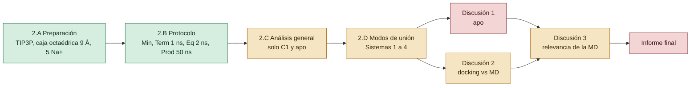
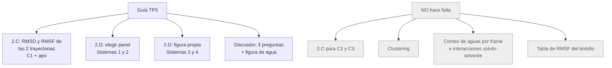
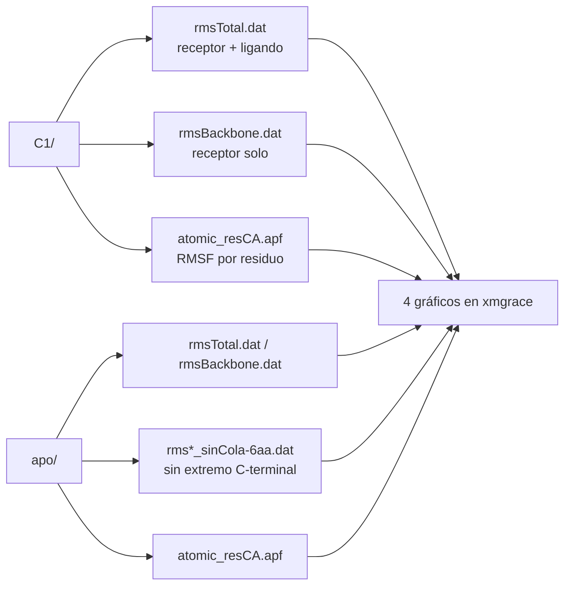
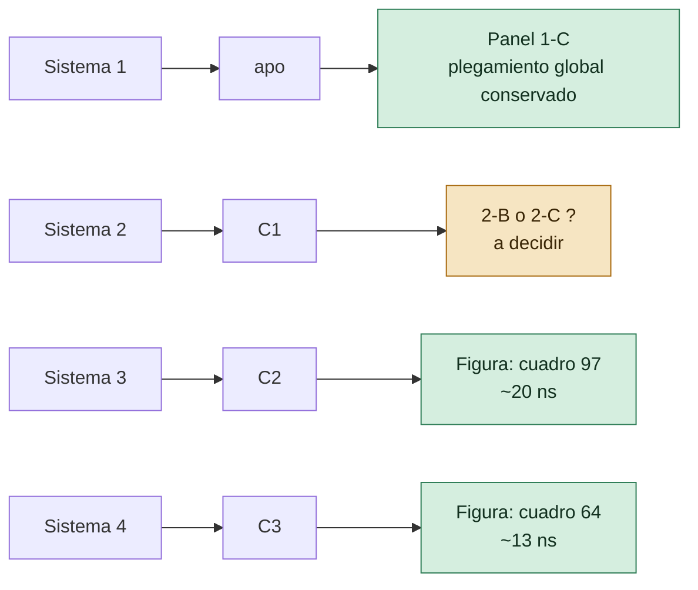
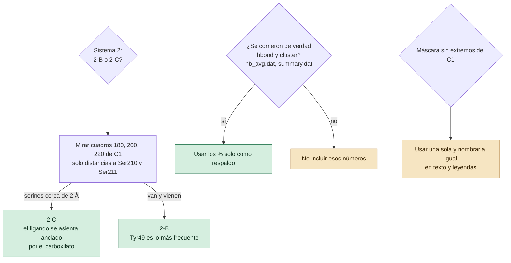
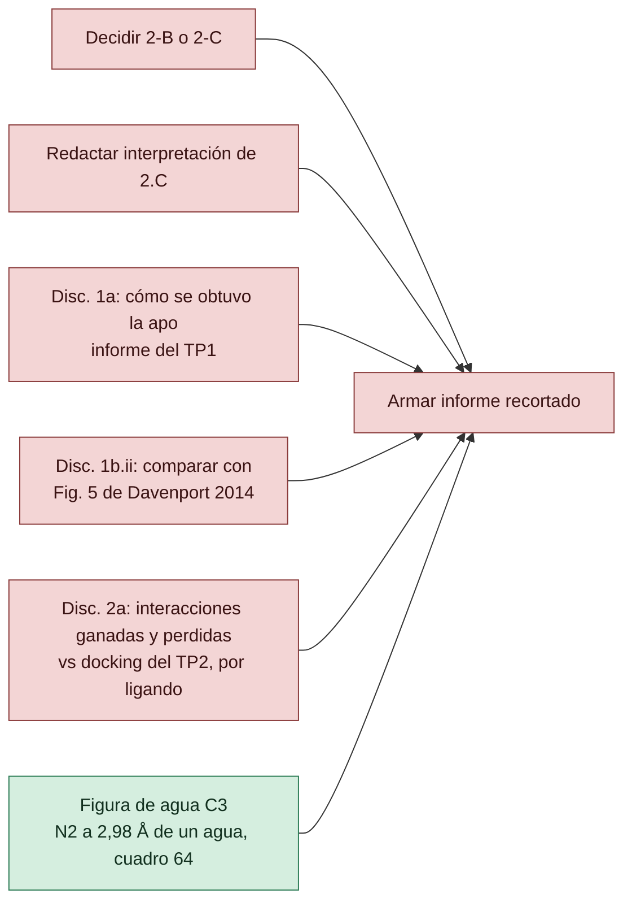

# Estado del TP3: Dinámica Molecular de SIRT1

Resumen para coordinar el informe: qué está hecho, qué hay que decidir juntos y qué falta. La idea es **hacer solo lo que pide la guía**, sin análisis extra.

Numeración (igual en VMD, cpptraj y en los paneles de la cátedra): residuos 1–279 = proteína, 280 = Zn, 281 = ligando.

## 1. Mapa general

Verde = hecho · Amarillo = parcial · Rojo = pendiente

## 2. Qué pide la guía (y qué no)

## 3. Análisis general (2.C): archivos de la cátedra

No hay que generar gráficos nuevos: la cátedra ya dejó todo calculado en cada carpeta.

| Gráfico | Archivos |
|---|---|
| RMSD receptor + ligando vs receptor solo (C1) | `C1/rmsTotal.dat` + `C1/rmsBackbone.dat` |
| RMSD C1 vs apo | `C1/rmsBackbone.dat` + `apo/rmsBackbone.dat` |
| RMSD apo con y sin extremos | `apo/rmsBackbone.dat` + `apo/rmsBackbone_sinCola-6aa.dat` |
| RMSF C1 vs apo | `C1/atomic_resCA.apf` + `apo/atomic_resCA.apf` |

- Eje X en cuadros: **1 cuadro ≈ 20,8 ps** en C1 (2400 cuadros = 50 ns). Se aclara en el título del eje.
- La verificación de extremos móviles se hace con el RMSF (valores altos en los extremos).
- **Falta:** redactar la interpretación (convergencia, RMSD intra e inter sistemas, RMSF).

## 4. Asignación de sistemas y elecciones de 2.D

Los cuadros son de VMD cargando con `step 10` (240 cuadros, ~0,21 ns cada uno). El ligando de los paneles 2 se identificó como C1 comparando estructuras (piridina, OH, piperidina, carboxilato).

| Sistema | Elección | Datos clave |
|---|---|---|
| 1 (apo) | **1-C** | El bolsillo se mantiene compacto; la superposición muestra el plegamiento conservado. Se respalda con el RMSD sin cola. |
| 2 (C1) | **2-B o 2-C** | Ver sección 5. |
| 3 (C2) | Cuadro 97 | Arg235 con el carboxilato (2,56 y 2,81 Å, puente salino bidentado); Lys213 NH → O8 (1,94 Å); OH del ligando → Gln114 (1,68 Å); Arg43 → O2 (2,86 Å). Lys213 y Arg43 se mantienen casi todo el tiempo; Arg235 fluctúa (por momentos hasta ~11 Å). |
| 4 (C3) | Cuadro 64 | Solo Arg215 interacciona con N1 (3,02 Å; 3,78 Å). Arg43 lejos (10–11 Å), Val181 a 4,58 Å. Sistema muy móvil, las argininas van y vienen. |

## 5. Decisiones para acordar juntos

Datos de C1 medidos en VMD (cuadros con `step 10`):

| Cuadro | Tyr49 | His132 | Ser211 | Ser210 |
|---|---|---|---|---|
| 0 | 4,00 | 3,55 | 1,86 | 6,20 |
| 120 | 3,50 | 6,12 | 2,58 | 5,88 |
| 163 (~34 ns) | 2,81 | 5,75 | 8,37 | 10,05 |
| 239 (final) | 4,38 | 7,73 | 1,56 | 1,97 |

El final se parece a 2-C, el cuadro 163 a 2-B. Los porcentajes de puentes de hidrógeno (tanto del borrador como de la trazabilidad) muestran Tyr49 como lo más frecuente y Ser210 poco frecuente (14–20 %), lo que favorece 2-B.

## 6. Correcciones al borrador del informe

| Dice el borrador | Corrección |
|---|---|
| C1: 2400 frames ≈ 48 ns | Son **50 ns** (1 cuadro ≈ 20,8 ps) |
| C2 y C3: 2500 frames | Verificar: la trazabilidad dice 2400 |
| Centrado con `autoimage` | El script de la cátedra usa `center :1-281@CA` e `image center familiar com` |
| Sin extremos: residuos 6–270 | Poner la máscara realmente usada (apo de la cátedra: `:1-274`) |
| Val181 "lo más consistente" en C3 | Según sus propios datos es 6,7 %: interacción rara; mejor no mencionarla o decir que no interacciona |
| Sistema 2 = 2-B | Pendiente de acordar (sección 5) |
| C3 figura en cuadro 641 | Coincide: es el cuadro 64 con `step 10` |
| Docking = primer cuadro de la MD | Aceptable, pero mejor comparar con las interacciones del informe del TP2 |
| 2.C para los 4 sistemas | La guía pide solo C1 y apo |

## 7. Pendientes

Nota sobre la figura de agua de C3: el agua está unida al N2 pero no conecta con ningún residuo, así que es **hidratación del ligando**, no un puente agua–proteína. El agua ocupa el lugar que dejó Arg43 al alejarse.
