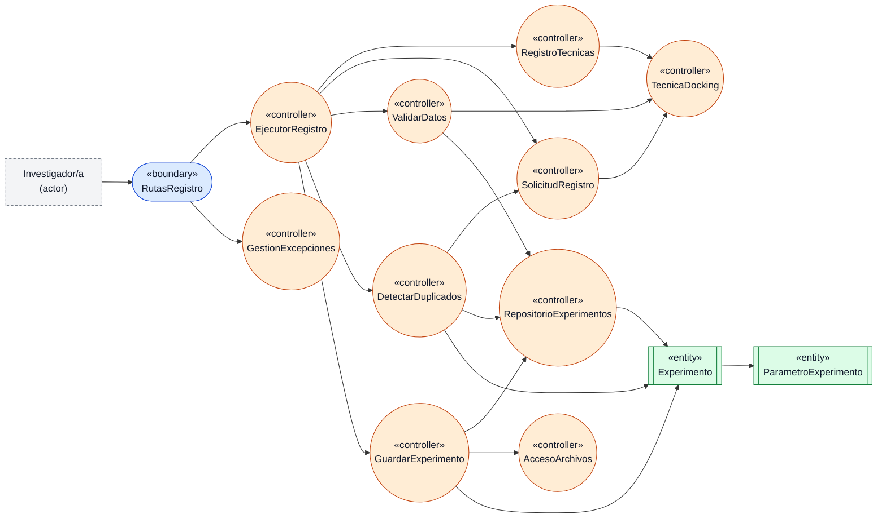
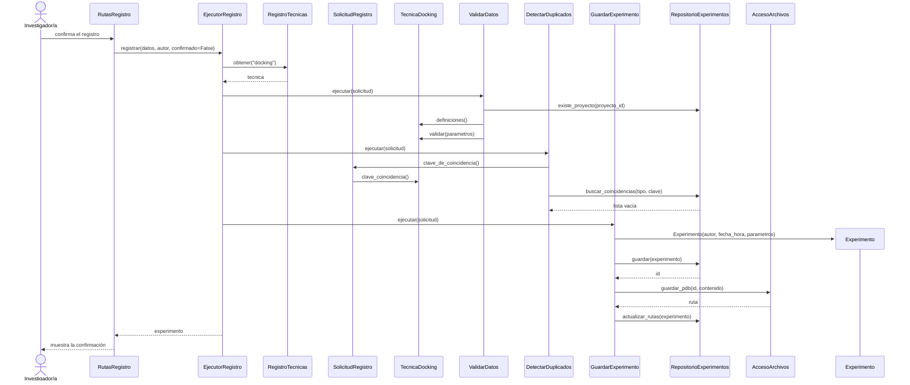
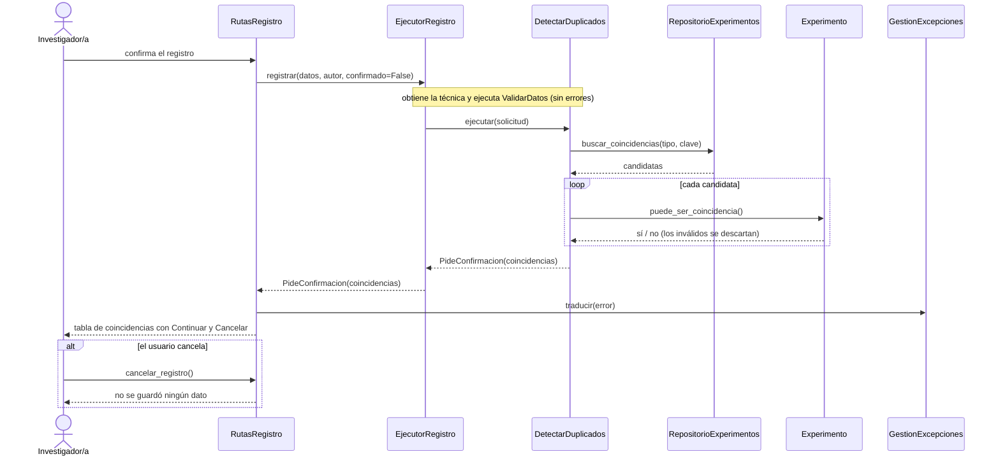
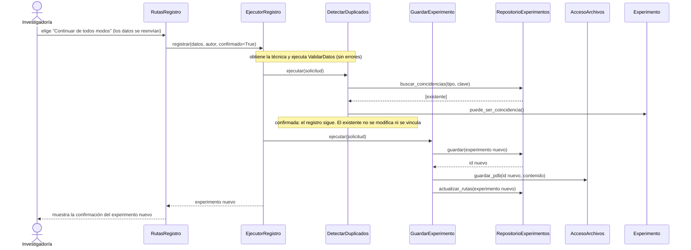
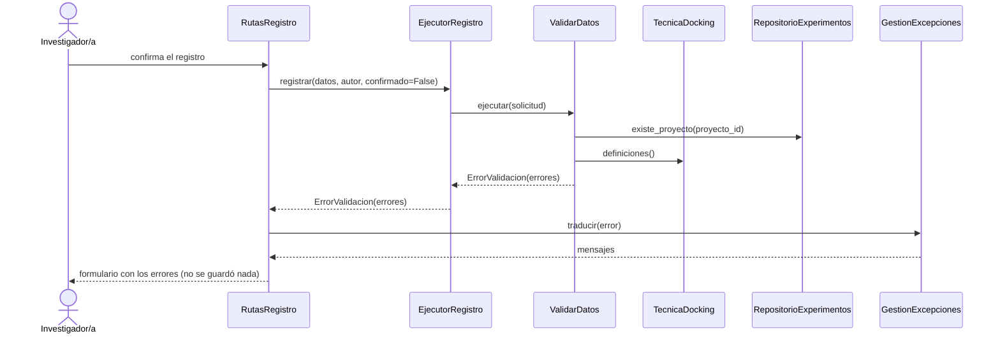
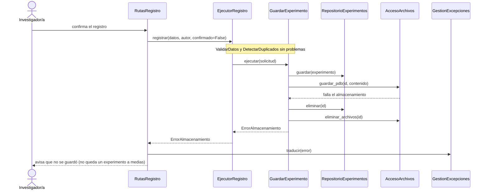
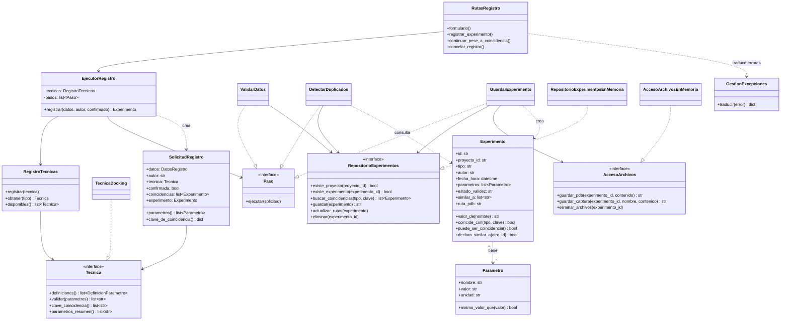

# BitacoraBio 2026 — Diseño detallado, implementación y pruebas (HU-01.A1)

**Materia:** Ingeniería del Software 2026 (FIUNER) · **Trabajo práctico:** TP4 — Diseño detallado, implementación y testing unitario
**Integrantes:** Nuñez Juliana, Segovia Lucas

---

## 1. Introducción

### 1.1 Propósito

Este documento baja a diseño detallado, código y pruebas una historia de usuario (HU) del sistema, partiendo de la arquitectura del TP3 (`docs/architecture/arquitectura.md`). Se trabaja **una sola HU de punta a punta**: análisis en tres dimensiones, diagrama de robustez, diagramas de secuencia, modelo de clases, implementación con interfaz gráfica mínima y pruebas unitarias con reporte de cobertura.

### 1.2 HU elegida

**HU-01.A1 · Continuar registro pese a coincidencia detectada** (deriva de CU-01, slice A1).

> Como investigador/a, quiero poder registrar igual mi experimento aunque el sistema encuentre uno similar ya cargado, para dejar constancia de una repetición intencional (por ejemplo, replicar un resultado o validar con otro software).

Criterio de aceptación:

- *Given* una coincidencia detectada por CU-00 y mostrada al investigador/a, *When* elige continuar de todos modos, *Then* el sistema registra el experimento como uno nuevo (autor, fecha), sin sobrescribir ni vincular el experimento existente.

**Alcance.** HU-01.A1 se trabaja con **HU-01.B1.1 (registrar experimento) incluida por completo como base**: A1 solo existe como una variante del registro, de modo que el diseño cubre el camino sin coincidencias de B1.1 (con sus tres criterios), el corte por coincidencia (que es el punto de partida de A1 y de E3) y la continuación de A1. Criterios de B1.1 que se incluyen:

1. Proyecto existente, campos obligatorios válidos y sin coincidencias: se registran autor y fecha/hora y se guarda el experimento.
2. Un experimento previo con la misma molécula/ligando pero "inválido" no se reporta como coincidencia.
3. Con los campos opcionales vacíos, el experimento se guarda sin exigirlos.

**Fuera de alcance (por decisión del grupo, por ahora):** la conexión con Google Docs. Quedan sin implementar el paso 4 del núcleo (*Vincular documento*), el *Cliente de Google Docs* y las historias HU-01.B1.2 y HU-01.E1. El registro se ejecuta con tres pasos y no crea documento de notas. Por eso, en esta entrega, "registra el experimento como uno nuevo" significa autor, fecha y datos guardados; el documento de notas propio de cada experimento se agregará cuando se retome esa parte.

### 1.3 Por qué esta HU

| Condición de la consigna | Cómo se cumple |
|---|---|
| Asociada a un escenario de calidad | `EC-07` (principal del TP3): el registro es donde cada técnica aporta lo propio, y A1 usa la clave de coincidencia que define cada técnica. También se relaciona con `EC-11` (varias coincidencias sin perder lo cargado) |
| Atraviesa la estructura | Recorre las cuatro capas: Rutas de registro (presentación) → Ejecutor de registro (servicios) → Registro de técnicas, Validar datos, Detectar duplicados, Guardar experimento y Técnica Docking (dominio) → Repositorio de experimentos y Acceso a archivos (acceso a datos) |
| Una decisión de arquitectura la afecta | `DA-02` (microkernel en el registro), `DA-03` (parámetros nombre-valor-unidad) y `DA-01` (capas) citan sus componentes |

Además de cumplir la consigna, A1 es relevante para el proyecto: la detección de duplicados es la razón de ser de BitacoraBio (evitar que el laboratorio repita un ensayo sin saberlo) y A1 es la salida cuando la repetición es **intencional**. Es la HU donde se juntan la regla central del negocio (qué es una coincidencia), el microkernel (la clave de coincidencia la define la técnica) y una decisión de flujo difícil de resolver bien: cortar el registro, pedir una confirmación y retomarlo sin pedir de nuevo los datos.

### 1.4 Siglas

HU: historia de usuario · CU: caso de uso · EC: escenario de calidad · DA: decisión de arquitectura · RF: requerimiento funcional · GRASP: patrones generales para asignar responsabilidades · CP: caso de prueba · PDB: formato de archivo de estructura molecular · C4: modelo de documentación de arquitectura en cuatro niveles · IA: inteligencia artificial.

---

## 2. Relación con la arquitectura

### 2.1 Tabla de coherencia

| Dimensión | Contenido |
|---|---|
| Funcionalidad | `HU-01.A1`, que incluye `HU-01.B1.1` como base. Slice de `CU-01` (con `CU-00`). Caminos: registro sin coincidencias (B1.1); corte por coincidencia con pedido de confirmación; continuar de todos modos (A1); rechazo por datos inválidos; falla al guardar archivos (se revierte) |
| Estructura | Contenedor *Aplicación del catálogo* (Python/Flask). Estilo: cliente-servidor como base y microkernel en el registro. Patrón: capas (presentación, servicios, dominio, acceso a datos y servicios externos). Componentes: **Rutas de registro** (presentación); **Ejecutor de registro** (servicios); **Registro de técnicas, Validar datos, Detectar duplicados, Guardar experimento y Técnica Docking** (dominio); **Repositorio de experimentos y Acceso a archivos** (acceso a datos). Componente principal: *Detectar duplicados* |
| Calidad | `EC-07`: agregar una técnica nueva sin modificar el núcleo ni columnas existentes. Tácticas: diferir el enlace (plug-ins) y parametrización (parámetros nombre-valor-unidad). Respaldo: `DA-02` y `DA-03` (con `DA-01`). También `EC-11` (varias coincidencias sin recargar lo cargado), que se resuelve reenviando los mismos datos con la confirmación |
| Dominio | `Experimento` y `ParametroExperimento` (se crean); `Proyecto` (se consulta su existencia); `ArchivoResultado` (el PDB se guarda en el almacén y el experimento conserva su ruta). Ver 3.2 |
| Verificación | Prueba `CP-11`: se agrega una técnica de prueba (dinámica molecular) solo con registrarla; el registro, la detección de duplicados con su clave y el guardado funcionan sin tocar el núcleo ni la entidad `Experimento`. Prueba `CP-05` para el criterio de A1 |

### 2.2 Estilo y patrones que rigen y cómo se respetan

| Restricción del TP3 | Cómo se respeta en el diseño |
|---|---|
| Capas: una capa no depende de las superiores; las flechas van hacia abajo | Las rutas llaman al servicio; el servicio, al dominio; el dominio, a las interfaces del acceso a datos. Ningún módulo importa uno de una capa superior |
| La capa de servicios no tiene lógica | `EjecutorRegistro.registrar` solo crea la solicitud, pide la técnica y ejecuta los pasos en orden. No tiene ningún `if` sobre reglas |
| Microkernel: los plug-ins no se comunican entre sí ni modifican el núcleo | `TecnicaDocking` solo implementa la interfaz `Tecnica`; no conoce otros plug-ins ni los pasos |
| Microkernel: lo propio de la técnica está en el plug-in | Parámetros, validaciones propias y clave de coincidencia están en `TecnicaDocking`; los pasos las leen a través de la solicitud y no nombran ninguna técnica |
| Los pasos no se llaman entre sí | Los ejecuta `EjecutorRegistro`; cada uno recibe y completa la `SolicitudRegistro` |

---

## 3. Diseño de la HU

### 3.1 Enunciado y criterios

Ver 1.2. Los criterios de aceptación de B1.1 y de A1 son la fuente de los casos de prueba (sección 7).

### 3.2 Entidades del modelo de dominio que intervienen

Se marcaron los sustantivos de los criterios (proyecto, campos obligatorios, molécula/ligando, coincidencia, experimento previo, estado de validez, autor, fecha/hora, campos opcionales, capturas) y se buscaron en el modelo de dominio del TP1.

| Entidad del modelo (TP1) | ¿Interviene? | Qué usa la HU de ella | La HU la... |
|---|---|---|---|
| `Experimento` | Sí | Tipo, autor, fecha/hora de carga, estado de validez, campos opcionales y relación "Similar a". Sabe si coincide con un tipo y una clave y si puede ser coincidencia (no lo es si es inválido) | Crea (el nuevo) y consulta (los previos) |
| `ParametroExperimento` | Sí | Nombre, valor y unidad. La molécula/proteína y el ligando son parámetros (`DA-03`) y forman la clave de coincidencia del docking | Crea (los del nuevo) y consulta (los de los previos) |
| `Proyecto` | Sí | Solo su existencia: el experimento se registra en un proyecto existente | Consulta, a través del repositorio |
| `ArchivoResultado` | Sí | El PDB: se guarda en el almacén y el experimento conserva su ruta (`DA-04`) | Crea |
| `CapturaResultado` | Sí, de forma mínima | Las capturas son opcionales; se guardan igual que el PDB | Crea |
| `Usuario` | Sí, de forma mínima | Solo el autor, que se toma del usuario identificado (RA-01: la autenticación está fuera del desarrollo) | Consulta |
| `DocumentoNotas` | **No** (fuera de alcance) | Es el documento de Google Docs; su conexión se deja para más adelante | — |

El modelo de dominio **no necesitó cambios**: la relación "Similar a" ya figura en el formulario del TP1/TP2 y se guarda como una lista de identificadores de experimentos.

### 3.3 Análisis tridimensional

| Dimensión | Elemento | Detalle |
|---|---|---|
| Funcionalidad | B1.1 criterio 1 | Con proyecto existente, campos válidos y sin coincidencias, registrar autor y fecha/hora y guardar el experimento |
| Funcionalidad | B1.1 criterio 2 | Un experimento previo inválido no se reporta como coincidencia |
| Funcionalidad | B1.1 criterio 3 | Los campos opcionales vacíos no impiden guardar |
| Funcionalidad | A1 | Con una coincidencia mostrada, si el usuario elige continuar, registrar un experimento nuevo sin sobrescribir ni vincular el existente |
| Funcionalidad | Rechazos | Datos faltantes o inválidos: informar y no guardar. Falla al guardar archivos: revertir y no dejar un experimento a medias |
| Estructura | Frontera | Rutas de registro: formulario, tabla de coincidencias con "Continuar" y "Cancelar", confirmación |
| Estructura | Control | Ejecutor de registro, Registro de técnicas, los tres pasos (validar, detectar duplicados, guardar), la solicitud de registro, el repositorio y el acceso a archivos |
| Estructura | Dominio | `Experimento` (sabe si coincide y si puede ser coincidencia) y `ParametroExperimento` |
| Calidad | `EC-07` | La clave de coincidencia, las validaciones y los parámetros los define el plug-in de la técnica: una técnica nueva no cambia el núcleo ni la entidad |
| Calidad | `EC-11` | Al continuar de todos modos no hay que volver a cargar ningún dato: se reenvía lo mismo con la confirmación |

### 3.4 Diagrama de robustez

Leyenda: borde punteado = actor; rectángulo redondeado azul = boundary; círculo naranja = controller; rectángulo con barras verde = entity.



Se verifican las reglas de conexión: el actor solo toca la pantalla; la pantalla solo toca controladores (el ejecutor y la gestión de excepciones, que es un aspecto transversal); ninguna entidad se accede desde la frontera. Las dos entidades salen de la tabla de 3.2. `SolicitudRegistro` es el objeto que lleva los datos del registro por los pasos (TP3, 5.2.2); no es un concepto del negocio y por eso se dibuja como controlador. `Proyecto` no se dibuja: alcanza con saber si existe, y eso lo responde el repositorio.

**Dónde vive cada regla de negocio**

| Regla | Dónde vive | Por qué |
|---|---|---|
| Un experimento inválido no cuenta como coincidencia | `Experimento.puede_ser_coincidencia()` (entidad) | La entidad conoce su estado (criterio Experto) y la regla no se puede saltear: cualquier camino que reciba un experimento pasa por ella |
| Dos experimentos coinciden si tienen el mismo tipo y los mismos valores en la clave | `Experimento.coincide_con(tipo, clave)` (entidad) y la clave en `TecnicaDocking` (plug-in) | La entidad conoce sus parámetros; qué parámetros forman la clave depende de la técnica (`EC-07`) |
| Un experimento declarado en "Similar a" no se reporta | `DetectarDuplicados` (paso del dominio) | Depende de la solicitud en curso, no de un experimento en particular |
| Con coincidencias sin confirmar el registro se corta; confirmadas, sigue | `DetectarDuplicados` | Es la regla del paso; el ejecutor no decide nada |
| Obligatoriedad, largo y formato de los datos | `ValidarDatos`, con las definiciones de la técnica | La parte común la aplica el núcleo; lo propio (qué es obligatorio) lo define el plug-in |
| Molécula/proteína y ligando no pueden ser el mismo | `TecnicaDocking.validar()` | Es una regla propia del docking |
| Siempre se crea un experimento nuevo; nunca se toca el existente | `GuardarExperimento` | No recibe ni modifica los experimentos de las coincidencias |
| Si falla el guardado de archivos se revierte el experimento | `GuardarExperimento` | Es lo que cierra la consistencia entre los dos almacenes (TP3, 5.6) |
| La pantalla solo muestra y reenvía | `RutasRegistro` | La pantalla ayuda, el dominio garantiza: no decide ni valida reglas |

**Asignación de cada elemento a un componente del TP3 y a su capa**

| Elemento | Componente del TP3 | Capa |
|---|---|---|
| RutasRegistro | Rutas de registro | Presentación |
| EjecutorRegistro | Ejecutor de registro | Servicios |
| RegistroTecnicas | Registro de técnicas | Dominio |
| TecnicaDocking | Técnica Docking | Dominio |
| ValidarDatos | Validar datos (paso 1) | Dominio |
| DetectarDuplicados | Detectar duplicados (paso 2) | Dominio |
| GuardarExperimento | Guardar experimento (paso 3) | Dominio |
| SolicitudRegistro | Objeto que viaja por el registro (no es un componente) | Dominio |
| Experimento, ParametroExperimento | Entidades del modelo de dominio: no son un componente del TP3 (ver 8.2) | Dominio |
| RepositorioExperimentos | Repositorio de experimentos | Acceso a datos |
| AccesoArchivos | Acceso a archivos | Acceso a datos |
| GestionExcepciones | Gestión de excepciones | Transversal |

### 3.5 Diagramas de secuencia

Se dibuja una secuencia por camino. Todas usan los participantes de la robustez. Los errores previstos (`PideConfirmacion`, `ErrorValidacion`, `ErrorAlmacenamiento`) son excepciones que cortan el registro: los pasos siguientes no se ejecutan.

**Secuencia A: registro sin coincidencias (B1.1, camino de éxito)**



**Secuencia B: coincidencia detectada, el registro se corta y el usuario decide**



**Secuencia C: continuar de todos modos (HU-01.A1)**



**Secuencia D: rechazo por datos faltantes o inválidos**



**Secuencia E: falla al guardar los archivos (se revierte)**



**Asignación de responsabilidades**

| Responsabilidad | Quién | Criterio GRASP |
|---|---|---|
| Saber si un experimento coincide con un tipo y una clave | `Experimento` | Experto en información: conoce sus parámetros |
| Saber si un experimento puede ser coincidencia (no es inválido) | `Experimento` | Experto en información: conoce su estado |
| Decidir qué parámetros forman la clave, qué es obligatorio y las reglas entre parámetros | `TecnicaDocking` | Experto en información (lo propio de cada técnica) y alta cohesión; es la táctica de `EC-07` (diferir el enlace) |
| Entregar la técnica de un tipo de ensayo | `RegistroTecnicas` | Experto en información: es el único que conoce los plug-ins; bajo acoplamiento (los pasos no nombran técnicas) |
| Armar la lista de parámetros y la clave a partir de lo que cargó el usuario | `SolicitudRegistro` | Experto en información: tiene los datos y la técnica |
| Validar datos obligatorios y formatos | `ValidarDatos` | Alta cohesión: un paso, una responsabilidad |
| Buscar coincidencias, filtrarlas y cortar el registro | `DetectarDuplicados` | Alta cohesión; usa las reglas de `Experimento` en lugar de repetirlas |
| Crear el `Experimento` nuevo con autor y fecha | `GuardarExperimento` | Creador: tiene los datos para iniciarlo y lo guarda |
| Coordinar el orden de los pasos | `EjecutorRegistro` | Controlador: orquesta sin hacer el trabajo del dominio |
| Obtener y guardar datos y archivos | `RepositorioExperimentos` y `AccesoArchivos` | Alta cohesión y bajo acoplamiento: los pasos no saben cómo se guarda |
| Traducir errores previstos en respuestas | `GestionExcepciones` | Aspecto transversal (TP3, 5.4) |
| Mostrar y reenviar el formulario | `RutasRegistro` | La frontera solo traduce entre el usuario y el controlador |

---

## 4. Modelo de clases

Un solo diagrama, derivado de las cinco secuencias. Las clases `RutasRegistro` (módulo `rutas_registro.py`, con sus funciones de Flask) y `GestionExcepciones` (módulo `gestion_excepciones.py`) se muestran como clases con las operaciones que usan las secuencias.



Además de estas clases, el código tiene `DatosRegistro` (lo que cargó el usuario, que la solicitud transporta), `DefinicionParametro` (nombre, unidad, obligatoriedad y largo de un parámetro de la técnica) y los errores previstos (`ErrorValidacion`, `PideConfirmacion`, `ErrorAlmacenamiento`). Son datos que viajan o se devuelven: no tienen colaboraciones propias y por eso no se dibujan.

---

## 5. Justificación del diseño

### 5.1 Responsabilidades y decisiones

| Decisión | Por qué | Costo |
|---|---|---|
| Las reglas de coincidencia (`coincide_con`, `puede_ser_coincidencia`) viven en `Experimento` | Es quien tiene los datos; la regla no se puede saltear y la entidad no es anémica. Los pasos solo la usan | La entidad conoce la noción de "clave", un concepto que viene del registro |
| La clave de coincidencia, las validaciones propias y los parámetros los define el plug-in (`Tecnica`) | Es lo que pide `EC-07`: una técnica nueva se agrega sin tocar el núcleo. Si estas reglas estuvieran en los pasos, cada técnica nueva los modificaría | Hay que mantener la interfaz de técnica; se diseñó con un solo ejemplo (docking), y puede ampliarse con la segunda (sacrificio ya declarado en el TP3) |
| `EjecutorRegistro` solo ordena | La consigna del TP3 pide una capa de servicios sin lógica. Para probar el orden y el corte alcanza un paso espía (`CP-10`) | Es una clase de pocas líneas; se justifica porque es el componente definido en el TP3 y el lugar donde se agregaría el paso 4 |
| Un único objeto (`SolicitudRegistro`) viaja por los pasos | Evita que los pasos se pasen datos entre sí (los pasos no se llaman) y es lo que decidió el TP3 | Es un objeto "bolsa de datos"; se acepta porque los pasos le agregan resultados en un orden fijo |
| Las interfaces `RepositorioExperimentos` y `AccesoArchivos` | La persistencia (en memoria o PostgreSQL) y el almacén (en memoria o servidor de archivos) se cambian sin modificar los pasos; además las pruebas usan las versiones en memoria y un doble que falla | Dos interfaces con una sola implementación real cada una; se justifica por el cambio previsto a PostgreSQL y por las pruebas |
| El corte por coincidencia es una excepción (`PideConfirmacion`) | El paso corta el registro sin que el ejecutor tenga que preguntar "¿hay que seguir?" después de cada paso, y lleva la lista de coincidencias | Se usa una excepción para un camino normal de negocio; se justifica porque es "un error previsto" según el TP3 (5.2.2) |
| Para continuar, el registro corre **desde el principio** con `confirmado=True` | Es la decisión del TP3 (re-envío con confirmación): no se guarda nada entre solicitudes, el servidor no necesita recordar la sesión y los datos se vuelven a validar | Repite la validación y la búsqueda; es despreciable para este volumen |
| Los datos y el PDB se reenvían en el propio formulario de coincidencias | Cumple `EC-11` (0 campos que recargar) sin guardar nada en el servidor | El PDB viaja dos veces; aceptable (unos 250 KB) |
| `GuardarExperimento` guarda primero el experimento y después los archivos, y revierte si falla | Los dos almacenes no comparten transacción (TP3, 5.6) | Si falla el propio `eliminar`, queda un residuo; se aceptó para el alcance y se menciona en los sacrificios del TP3 |

### 5.2 Patrones de diseño usados

No se usaron patrones de diseño por obligación. Aparecen dos por el problema concreto que resuelven:

| Patrón | Problema que resuelve | Dónde está |
|---|---|---|
| Strategy (la interfaz `Tecnica` con sus implementaciones) | Variar parámetros, validaciones y clave de coincidencia según el tipo de ensayo sin condicionales en el núcleo (`EC-07`) | `Tecnica`, `TecnicaDocking` y `RegistroTecnicas` en el diagrama de clases |
| Repository (`RepositorioExperimentos`) | Que el dominio no conozca cómo se guardan los datos | `RepositorioExperimentos` y su implementación en memoria |

No se usó Factory para elegir la técnica: un diccionario en `RegistroTecnicas` alcanza.

---

## 6. Implementación

### 6.1 Estructura del código

```text
src/
├── dominio/          # entidades, solicitud, interfaz de técnica, plug-in Docking, Registro de técnicas, pasos del registro y puertos
│   └── pasos/        # Paso, ValidarDatos, DetectarDuplicados, GuardarExperimento
├── servicios/        # EjecutorRegistro (y ServicioConsulta, apoyo de la interfaz)
├── acceso_datos/     # implementaciones en memoria de los puertos
├── presentacion/     # Rutas de registro (Flask) y plantillas HTML
├── transversal/      # Gestión de excepciones
└── arranque.py       # único lugar que arma los objetos concretos
tests/
```

Las cuatro capas del TP3 se ven como carpetas. Las dependencias van en un solo sentido: presentación → servicios → dominio; el acceso a datos implementa los puertos del dominio y solo usa sus entidades.

### 6.2 Cómo se ejecuta

Las instrucciones completas están en el `README.md`: instalar con `pip install -r requirements.txt`, abrir la interfaz con `python run.py` (en `http://localhost:5000/registro`) y correr las pruebas con `pytest`.

### 6.3 Cómo se reemplazan la persistencia y los servicios externos

- **Persistencia:** se eligió una implementación **en memoria** (`RepositorioExperimentosEnMemoria`). Para usar PostgreSQL se escribe otra clase que cumpla `RepositorioExperimentos` y se la pasa en `arranque.py`; ni los pasos ni el ejecutor cambian.
- **Archivos:** `AccesoArchivosEnMemoria` simula el servidor de archivos del laboratorio, detrás de la interfaz `AccesoArchivos`.
- **Google Docs:** fuera de alcance. Al retomarlo, se agrega un `ClienteGoogleDocs` (con una versión simulada) y el paso `VincularDocumento` a la lista de pasos de `arranque.py`.
- **Autenticación:** fuera del desarrollo (TP3): el autor se toma de un usuario identificado fijo (`investigadora.demo`).

---

## 7. Pruebas

### 7.1 Estrategia

Pruebas unitarias con pytest sobre el dominio y la capa de servicios, **sin pasar por la interfaz gráfica**. Los colaboradores son implementaciones en memoria, y para la falla de archivos se usa un doble de prueba (`ArchivosQueFallan`). Se usaron las técnicas de la referencia: caja negra (criterios de aceptación; clases de equivalencia; valores límite, como el largo máximo y la fecha de hoy contra la de mañana) y caja blanca (cada rama de los pasos: con y sin confirmación, inválido y válido, falla y éxito del guardado).

### 7.2 Tabla de casos de prueba

| ID | Técnica | Origen | Dado (entrada y estado) | Resultado esperado | Prueba |
|---|---|---|---|---|---|
| CP-01 | Caja negra | B1.1, criterio 1 | Proyecto existente, datos válidos y sin coincidencias | Se registra con autor y fecha/hora; el experimento y el PDB quedan guardados | `test_cp01_...` |
| CP-02 | Caja negra | B1.1, criterio 2 | Existe un experimento con la misma molécula/ligando pero inválido | No se reporta como coincidencia; se guarda como el camino normal | `test_cp02_...` |
| CP-03 | Caja negra | B1.1, criterio 3 | Campos opcionales vacíos | Se guarda sin exigirlos | `test_cp03_...` |
| CP-04 | Caja negra | A1 / E3, punto de partida | Existe un experimento coincidente; confirmado=False | Se corta con `PideConfirmacion` y la lista; no se guardó nada | `test_cp04_...` |
| CP-05 | Caja negra | **A1, criterio de aceptación** | Existe un coincidente; confirmado=True | Se registra un experimento nuevo (id distinto); el existente no cambia; no hay vínculo entre ambos | `test_cp05_...` |
| CP-06 | Caja negra | EC-11 | Se registra con los mismos datos, primero sin y después con confirmación | La segunda vez se registra sin cargar nada de nuevo | `test_cp06_...` |
| CP-07 | Caja negra, partición | A1 | Dos experimentos coincidentes | La coincidencia informa los dos | `test_cp07_...` |
| CP-08 | Caja blanca | Orden de los pasos | Datos sin PDB y existe un coincidente | `ErrorValidacion` (no `PideConfirmacion`); no se guarda nada | `test_cp08_...` |
| CP-09 | Caja negra | Tipo | Tipo "cristalografia" | `ErrorValidacion` | `test_cp09_...` |
| CP-10 | Caja blanca | Ejecutor | Pasos espía; el segundo falla | Se ejecutan en orden y el tercero no se ejecuta | `test_cp10_...` |
| CP-11 | Caja negra | **EC-07** | Se registra el plug-in de dinámica molecular (de prueba) y se carga un experimento con `paso_tiempo` en fs | Se registra con la misma entidad; el parámetro tiene unidad; el duplicado se detecta con la clave de la técnica nueva; docking sigue funcionando | `test_cp11_...` |
| CP-12 | Caja negra | B1.1 | Fecha de realización 2/11 | Se conserva | `test_cp12_...` |
| CP-13 | Caja negra | B1.1, validaciones | Proyecto inexistente; fecha vacía; fecha futura (límite: hoy sí, mañana no); sin PDB; parámetro obligatorio vacío (tres casos); largo 100 (pasa) y 101 (falla); extra sin nombre; "Similar a" inexistente y existente; proteína igual a ligando | Cada una devuelve su error o pasa; si hay varios, se informan juntos | `test_validar_datos.py` (14 pruebas) |
| CP-14 | Caja blanca | RF-03 | Sin coincidencias; con y sin confirmar; inválido; en "Similar a"; otro ligando; otro tipo; el paso no escribe | Ver `test_detectar_duplicados.py` (8 pruebas) | `test_detectar_duplicados.py` |
| CP-15 | Caja blanca | Guardado | Guardado exitoso; opcionales vacíos; capturas; dos registros iguales; falla de archivos | Se guarda con autor, fecha y parámetros con unidad; dos registros iguales dan dos experimentos; si falla el guardado de archivos (incluida una captura) se revierte todo | `test_guardar_experimento.py` (5 pruebas) |
| CP-16 | Caja blanca | Entidades | Misma clave con otra capitalización/espacios; otro tipo; otro ligando; sin el parámetro; estados de validez (tres); estado desconocido | `coincide_con` y `puede_ser_coincidencia` responden según la regla | `test_entidades.py` (12 pruebas) |
| CP-17 | Caja blanca | Técnica y registro | Obligatorios del docking; proteína igual a ligando; clave y resumen; registrar y obtener; tipo desconocido | Ver `test_tecnicas.py` (6 pruebas) | `test_tecnicas.py` |
| CP-18 | Caja blanca | Gestión de excepciones | Cada tipo de error previsto | Respuesta con tipo y mensajes para el usuario | `test_gestion_excepciones.py` (4 pruebas) |

En total hay **62 pruebas**; todas pasan al ejecutarlas desde cero. La prueba de calidad de `EC-07` es `CP-11`; la del criterio de A1 es `CP-05`.

### 7.3 Resultados y cobertura

Ver `docs/design/cobertura.md`.

---

## 8. Trazabilidad y coherencia con la arquitectura

### 8.1 Tabla de verificación de coherencia

| Verificación | ¿Se cumple? | Evidencia |
|---|---|---|
| Cada participante de las secuencias pertenece a un componente de la ficha | Sí | Tabla "Asignación de cada elemento a un componente" (3.4) |
| Cada mensaje entre componentes está en el catálogo de relaciones del TP3 | Sí, tras dos ajustes al TP3 | Ver 8.2: se agregaron "Validar datos → Repositorio de experimentos" y "Rutas de registro → Servicio de consulta". El resto ya estaba (Rutas → Ejecutor; Ejecutor → Registro de técnicas y pasos; Detectar y Guardar → Repositorio; Guardar → Acceso a archivos; Rutas → Gestión de excepciones) |
| El diseño respeta el estilo y los patrones del contenedor | Sí | 2.2. Las dependencias del código van hacia abajo; el ejecutor no tiene lógica |
| La táctica del escenario de calidad aparece como operación o mensaje | Sí | `RT: obtener("docking")` y `T: definiciones()`, `T: validar()`, `T: clave_coincidencia()` en la secuencia A: el núcleo pide a la técnica lo propio. Es "diferir el enlace" y "parametrización" de `EC-07` |
| Cada entidad del diagrama de robustez está en el modelo de dominio del TP1 | Sí | Tabla de entidades (3.2): `Experimento` y `ParametroExperimento` |
| Cada entidad que interviene según 3.2 aparece en el diseño, o se explica por qué no | Sí | `Experimento` y `ParametroExperimento` en robustez y clases; `Proyecto`, `ArchivoResultado`, `CapturaResultado` y `Usuario` se explican en 3.2 (existencia, rutas y autor); `DocumentoNotas` queda fuera de alcance |
| La medida del escenario tiene una prueba que la verifica | Sí | `CP-11` (EC-07) y `CP-06` (EC-11) |

### 8.2 Actualizaciones al TP3 que surgieron del diseño

Al bajar a diseño aparecieron cuatro diferencias, que se actualizaron en `docs/architecture/arquitectura.md`:

1. **Falta la relación "Validar datos → Repositorio de experimentos".** El paso 1 necesita saber si el proyecto y los experimentos de "Similar a" existen. Se agregó al diagrama y al catálogo de relaciones (7.3).
2. **Falta la relación "Rutas de registro → Servicio de consulta".** El formulario necesita la lista de proyectos y de experimentos (campo "Similar a"). Se agregó al diagrama y al catálogo.
3. **Dónde se excluyen los inválidos y los declarados en "Similar a".** La sección 9 decía que lo hacía el Repositorio. Al aplicar el criterio Experto se vio que es una regla de negocio: el repositorio trae los experimentos del mismo tipo y clave, y el paso *Detectar duplicados* (y la entidad `Experimento`) las excluyen. Se corrigió la fila de la sección 9 (ya coincidía con la descripción del componente en 7.2).
4. **Entidades y puertos.** Las entidades del modelo de dominio no eran un componente en el TP3 y se aclaró que viven en la capa de dominio. Las interfaces de repositorio y de archivos las define el dominio y las implementa el acceso a datos (inversión de dependencias), de modo que el acceso a datos usa las entidades pero no los pasos ni los plug-ins del dominio. Se precisó en 5.3 y en 7.4.

No hizo falta cambiar el modelo de dominio del TP1.

### 8.3 Trazabilidad

| HU / escenario | Componente C4 | Clases | Archivo | Pruebas |
|---|---|---|---|---|
| B1.1 criterio 1 (registrar) | Rutas de registro → Ejecutor de registro → los pasos | `RutasRegistro`, `EjecutorRegistro`, `ValidarDatos`, `DetectarDuplicados`, `GuardarExperimento` | `src/presentacion/rutas_registro.py`, `src/servicios/ejecutor_registro.py`, `src/dominio/pasos/*.py` | CP-01, CP-12, CP-13, CP-15 |
| B1.1 criterio 2 (excluir inválidos) | Detectar duplicados | `DetectarDuplicados`, `Experimento` | `src/dominio/pasos/detectar_duplicados.py`, `src/dominio/entidades.py` | CP-02, CP-14, CP-16 |
| B1.1 criterio 3 (opcionales vacíos) | Guardar experimento, Validar datos | `GuardarExperimento`, `ValidarDatos` | `src/dominio/pasos/guardar_experimento.py` | CP-03, CP-15 |
| A1 (continuar de todos modos) | Rutas de registro, Detectar duplicados, Guardar experimento | `RutasRegistro`, `DetectarDuplicados`, `GuardarExperimento`, `SolicitudRegistro` | `src/presentacion/rutas_registro.py`, `src/dominio/pasos/detectar_duplicados.py` | CP-04, CP-05, CP-06, CP-07, CP-14 |
| Rechazos (datos, tipo, almacenamiento) | Validar datos, Guardar experimento, Gestión de excepciones | `ValidarDatos`, `GuardarExperimento`, `GestionExcepciones` | `src/dominio/pasos/validar_datos.py`, `src/transversal/gestion_excepciones.py` | CP-08, CP-09, CP-13, CP-15, CP-18 |
| EC-07 | Registro de técnicas, Técnica Docking | `RegistroTecnicas`, `Tecnica`, `TecnicaDocking` | `src/dominio/registro_tecnicas.py`, `src/dominio/tecnica.py`, `src/dominio/tecnica_docking.py` | CP-10, CP-11, CP-17 |
| EC-11 | Rutas de registro | `RutasRegistro` | `src/presentacion/rutas_registro.py`, plantilla `coincidencias.html` | CP-06 |

Todo criterio de aceptación llega al menos a una prueba, y toda clase del diagrama aparece en alguna secuencia (`SolicitudRegistro` en la A; `GestionExcepciones` en la B, D y E; `Experimento` en la A, B y C; `Parametro` es parte de `Experimento`).

---

## 9. Glosario y bibliografía

**Glosario.** *Solicitud de registro*: objeto único que lleva los datos del registro por los pasos. *Plug-in de técnica*: componente que declara lo propio de un tipo de ensayo (parámetros, validaciones, clave de coincidencia). *Clave de coincidencia*: parámetros que, junto con el tipo, definen que dos experimentos son "el mismo". *Error previsto*: excepción que el sistema espera y traduce en una respuesta para el usuario. *Doble de prueba*: implementación simulada de un colaborador, usada en las pruebas.

**Bibliografía.**

- Valotto, V. *Diseño tridimensional de software*. 2025.
- Larman, C. *Applying UML and Patterns*. Prentice Hall (criterios GRASP).
- Gamma, E., Helm, R., Johnson, R. y Vlissides, J. *Design Patterns*. Addison-Wesley.
- Rosenberg, D. y Stephens, K. *Use Case Driven Object Modeling with UML*. Apress, 2007.
- Bass, L., Clements, P. y Kazman, R. *Software Architecture in Practice* (tácticas).
- Documentación de pytest y de Flask.
