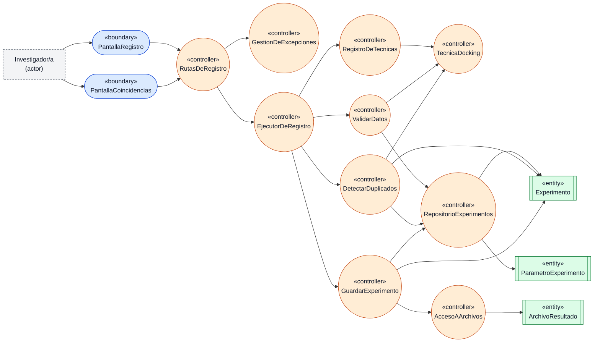
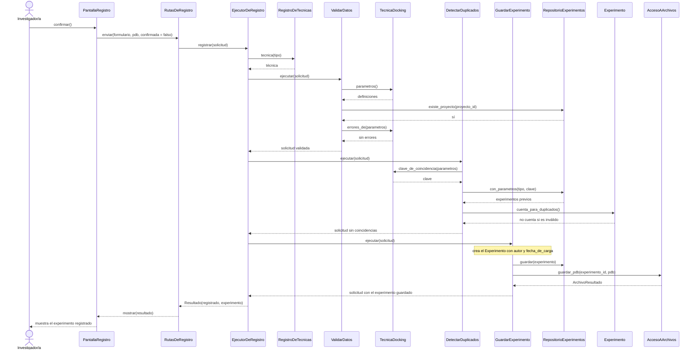
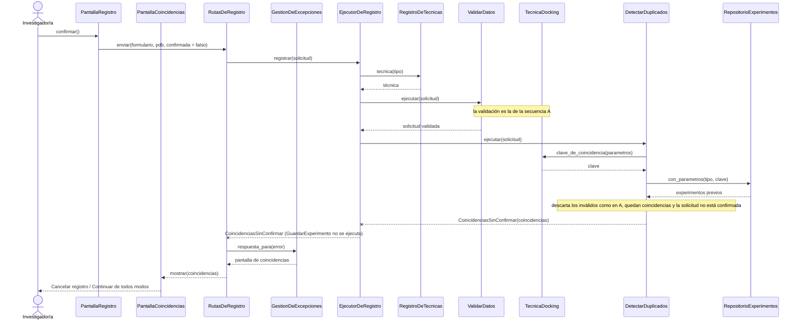
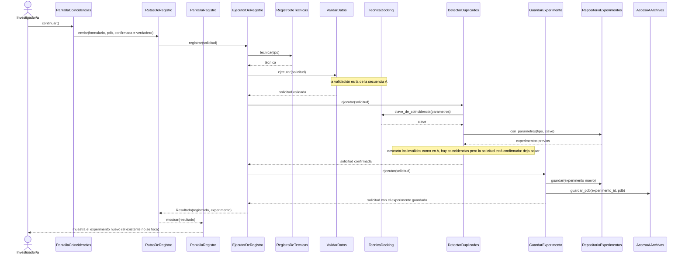
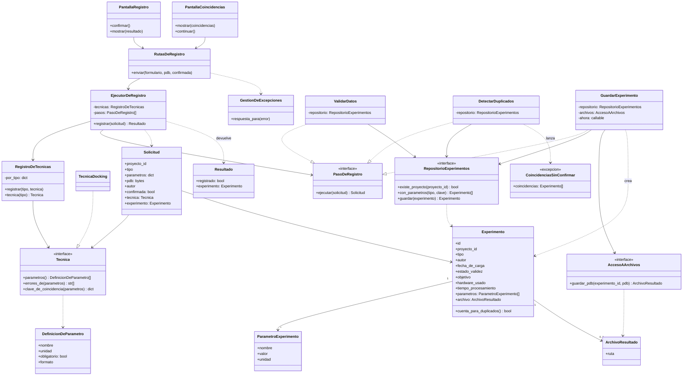

# Diseño detallado — BitacoraBio 2026 (TP4)

> **Estado: Parte A completa (pasos 1 a 6), sin código todavía.** Las secciones 6 (implementación) y 7 (pruebas) están planificadas y se completan en las partes B y C. Se apoya en la arquitectura vigente de `docs/architecture/arquitectura.md` (cuatro capas, microkernel en el registro, `EC-07` como driver principal).

## 1. Introducción

**Propósito.** Pasar de la arquitectura del TP3 al diseño detallado de una historia de usuario (HU): su análisis, su diagrama de robustez, sus diagramas de secuencia y su modelo de clases.

**HU elegida.** `HU-01.A1` · *Continuar registro pese a coincidencia detectada*, junto con `HU-01.B1.1` · *Registrar experimento de docking (guardado)*, que es su base: sin el registro normal no hay nada que "continuar". Queda afuera `HU-01.B1.2` (vincular el documento de notas), que depende de Google Docs.

**Por qué esta HU** (la consigna pide algo más que cumplir las condiciones):

- Es el corazón del valor del sistema: el SRS dice que el catálogo existe para "saber si ya se probó algo similar antes de perder tiempo repitiendo un ensayo". `HU-01.A1` es el momento en que el sistema avisa y el investigador/a decide.
- Tiene reglas de negocio reales (qué es una coincidencia, que un experimento inválido no cuenta, que continuar exige una confirmación explícita) y más de un camino. No es un alta con campos simples.
- Es la HU donde se ve el escenario principal del proyecto, `EC-07`: qué es "el mismo ensayo" lo define la técnica, no el Detector, así que un tipo de ensayo nuevo no obliga a tocarlo.

**Alcance de este TP.**

| Entra | No entra |
|---|---|
| Registro hasta guardar el experimento: validar, detectar duplicados, guardar (pasos 1 a 3 del registro) | Vincular el documento de notas y su reintento (`HU-01.B1.2`, `HU-01.E1`): paso 4 del registro |
| Los tres caminos: sin coincidencia, coincidencia que corta el registro, continuar de todos modos | Cancelar por coincidencia (`HU-01.E3`): es consecuencia del corte, sin diseño propio |
| Docking como único plug-in de técnica | Dinámica molecular: es el caso que ejercita `EC-07`, se verifica con una técnica de prueba |
| Los errores `E5` y `E6` (validación), solo como parte del paso 1 | `E2` (conexión interrumpida), `E4` (proyecto inexistente) y el campo "Similar a": ver 2.3 |

> ⚠ **Ajuste a la HU.** El criterio de `HU-01.A1` dice "(autor, fecha, **documento de notas propio**)". Como `HU-01.B1.2` queda afuera, acá el criterio se cumple hasta "autor y fecha, como experimento nuevo, sin sobrescribir ni vincular el existente". El documento de notas se verifica cuando se incorpore `HU-01.B1.2`.

**Siglas.** HU: historia de usuario. EC: escenario de calidad. DA: decisión de arquitectura. GRASP: principios de asignación de responsabilidades. PDB: formato de archivo de estructura molecular. RF: requerimiento funcional. CP: caso de prueba.

---

## 2. Relación con la arquitectura

### 2.1 Tabla de coherencia

| Dimensión | Contenido |
|---|---|
| Funcionalidad | `HU-01.A1` sobre `HU-01.B1.1`. Deriva de `CU-01`, slices A1 y B1.1, e incluye `CU-00` (Detectar duplicado). Realiza `RF-01`, `RF-02`, `RF-03`, `RF-04` y `RF-08` |
| Calidad | **`EC-07`** (driver principal): agregar un tipo de ensayo nuevo sin alterar ninguna columna existente y en menos de una jornada. Táctica: *diferir el enlace* con plug-ins. Decisiones: **`DA-02`** (microkernel en el registro), que fija además la medida propia "agregar la técnica no modifica ningún componente del núcleo", y **`DA-03`** (parámetros nombre-valor-unidad). `EC-08` ya no es driver, pero la separación en capas (`DA-01`) igual deja al Detector aislado |
| Estructura | Contenedor *Aplicación del catálogo*. Estilo base cliente-servidor; en el registro, microkernel (núcleo + plug-ins). Patrón de capas relajadas: presentación, servicios, dominio y acceso a datos |
| Componentes | **Principal:** *Detectar duplicados* (dominio, núcleo, paso 2). **También:** *Rutas de registro* (presentación); *Ejecutor de registro* (servicios); *Registro de técnicas*, *Técnica Docking*, *Validar datos* y *Guardar experimento* (dominio); *Repositorio de experimentos* y *Acceso a archivos* (acceso a datos); *Gestión de excepciones* (transversal) |
| Dominio | `Experimento`, `ParametroExperimento` y `ArchivoResultado` (los crea o consulta); `Usuario` (autor) y `Proyecto` (referencia). Detalle en 2.2 |
| Verificación | `EC-07`: se registra una técnica de prueba distinta del docking y se comprueba que el registro completo funciona sin modificar ningún archivo del núcleo (`CP-08`). Es la prueba de la medida de `DA-02`. La medida del TP2 (0 columnas modificadas) se verifica en la misma prueba: la técnica nueva guarda sus datos solo como filas de `ParametroExperimento` |

### 2.2 Entidades del modelo de dominio del TP1

| Entidad del TP1 | ¿Interviene? | Qué usa la HU de ella | La HU la... |
|---|---|---|---|
| `Experimento` | Sí | Tipo, autor, fecha de carga, estado de validez, campos opcionales (objetivo, hardware, tiempo) y parámetros | **Crea** (el nuevo) y **consulta** (los previos, para detectar coincidencias) |
| `ParametroExperimento` | Sí | Nombre, valor y unidad de cada parámetro. En docking incluye molécula/proteína, ligando y software (`DA-03`) | Crea; consulta (clave de coincidencia) |
| `ArchivoResultado` | Sí | El PDB es obligatorio al registrar (lo exige el formulario) | Crea |
| `Usuario` | Sí | Identidad del autor (relación "registra") | Consulta; no lo modifica |
| `Proyecto` | Referencia | Solo su identificador: `Validar datos` comprueba que existe | Consulta la existencia; no lo modifica |
| `CapturaResultado` | No | Son opcionales y `RF-11` no tiene historia propia | — |
| `DocumentoNotas` | No | Es de `HU-01.B1.2`, que queda afuera | — |

### 2.3 Cambios y decisiones sobre el modelo y el alcance

| Cambio o decisión | Motivo |
|---|---|
| **Cambio al modelo de dominio del TP1** (aplicado en `srs.md`): `Experimento` suma los atributos `tipo` y `fecha_de_carga` | `RF-02` y `RF-03` hablan de la fecha de carga y de comparar "el mismo tipo"; el modelo no los mostraba. El autor ya está en la relación `Usuario "registra" Experimento` |
| Molécula/proteína, ligando, software, sitio activo e hipótesis **no** son atributos de `Experimento`: son parámetros de la técnica | Es lo que dice `DA-03` y lo que permite que `EC-07` cumpla "0 columnas modificadas" (una técnica sin ligando no deja una columna vacía). Para la hipótesis es una decisión de este diseño: se la trata como parámetro opcional sin unidad |
| El campo **"Similar a"** del mockup no se modela | Lo usan *Validar datos* y *Detectar duplicados* en el TP3, pero no está en el SRS ni en el modelo de dominio, y `HU-01.A1` dice "sin vincular el experimento existente". Ninguna de las HU elegidas lo ejercita. **Pendiente del grupo:** o entra al SRS (con modelo y HU) o sale del TP3 |
| `E4` (proyecto inexistente): `Validar datos` consulta la existencia del proyecto, pero el camino de error no se desarrolla | El SRS lo nombra sin desarrollar |

### 2.4 Verificación de coherencia con la arquitectura (paso 6)

| Verificación | ¿Se cumple? | Evidencia |
|---|---|---|
| Cada participante de las secuencias pertenece a un componente de la ficha | Sí | Tabla "Elemento → componente → capa" de 3.3 |
| Cada mensaje entre componentes está en el catálogo de relaciones del TP3 (7.3) | Sí, con una salvedad | Tabla 3.5. La salvedad: las llamadas de los pasos al plug-in no se dibujan en el TP3 a propósito (nota de 7.3: dependen de la técnica elegida, no de un plug-in en particular) |
| El diseño respeta las restricciones del estilo (microkernel, Tabla 4) | Sí | Los plug-ins (`Tecnica`) no se llaman entre sí, no acceden a la base, a los archivos ni a Google Docs, y solo los entrega el `RegistroDeTecnicas`. El núcleo no tiene reglas de docking: la clave de coincidencia sale de `TecnicaDocking` (ver `CP-08`) |
| El diseño respeta las restricciones del patrón (capas relajadas, Tabla 6) | Sí | Todas las flechas de 3.5 van hacia abajo: servicios → dominio → acceso a datos. Las rutas llaman al ejecutor y a Gestión de excepciones (transversal). Ninguna capa inferior conoce a una superior |
| La táctica del escenario aparece como operación o mensaje | Sí | `EjecutorDeRegistro → RegistroDeTecnicas: tecnica(tipo)` y `DetectarDuplicados → Tecnica: clave_de_coincidencia(...)` en las tres secuencias |
| Cada entidad del diagrama de robustez está en el modelo de dominio del TP1 (o se agregó) | Sí | Tabla 2.2 y cambio de 2.3 |
| Cada entidad que interviene según el paso 1 aparece en el diseño | Sí | `Experimento`, `ParametroExperimento` y `ArchivoResultado` están en robustez y en clases. `Usuario` y `Proyecto` viajan como identificadores dentro de la solicitud, y por eso no se dibujan |
| La medida del escenario tiene una prueba que la verifica | Planificada | `CP-08` (sección 7). Se confirma cuando se ejecute |

**Diferencias entre el TP3 y este diseño** (la consigna pide decir qué cambió al bajar al detalle):

| TP3 | TP4 | Motivo |
|---|---|---|
| La técnica "se agrega a la solicitud" | La `Solicitud` guarda la técnica y los pasos la usan por la interfaz `Tecnica` | Es lo que dice 5.2.2; acá se le da nombre y operaciones |
| *Validar datos* verifica "campos comunes y parámetros de la técnica" | Se separa: *Validar datos* aplica obligatoriedad y formato con `parametros()`, y la técnica aporta solo sus reglas propias con `errores_de(...)` | Un solo lugar para la obligatoriedad, para todas las técnicas |
| *Repositorio de experimentos* "busca por parámetros" | Operación `con_parametros(tipo, clave)`, que devuelve **todos** los previos con esa clave | El repositorio no decide reglas; la regla "un inválido no cuenta" la tiene la entidad |
| "Similar a" en Validar y Detectar | No se modela | Ver 2.3 |

---

## 3. Diseño de la HU

### 3.1 Enunciado y criterios de aceptación

**`HU-01.B1.1`.** Como investigador/a, quiero registrar un experimento de docking con sus parámetros y saber si ya se probó algo similar, para no repetir un ensayo sin saberlo y dejar el catálogo del grupo actualizado.

- **B1.1-c1.** *Given* un proyecto existente, todos los campos obligatorios completos y con formato válido, y sin coincidencias previas, *When* confirma el registro, *Then* se registran autor y fecha/hora de carga y se guarda el experimento.
- **B1.1-c2.** *Given* un experimento previo con la misma molécula/ligando pero `estado_validez` "inválido", *When* confirma, *Then* **no** se reporta como coincidencia y se guarda como en el camino normal.
- **B1.1-c3.** *Given* un proyecto existente y los campos obligatorios completos, con los opcionales (hardware, tiempo de procesamiento, objetivo, hipótesis, notas y capturas) vacíos, *When* confirma, *Then* se guarda sin exigirlos.

**`HU-01.A1`.** Como investigador/a, quiero poder registrar igual mi experimento aunque el sistema encuentre uno similar, para dejar constancia de una repetición intencional.

- **A1-c1.** *Given* una coincidencia detectada y mostrada, *When* elige continuar de todos modos, *Then* se registra como experimento nuevo, sin sobrescribir ni vincular el existente (el documento de notas queda para `HU-01.B1.2`).

**Tres caminos.**

| Camino | Criterios | Resultado |
|---|---|---|
| **A.** Sin coincidencia (incluye el previo inválido y los opcionales vacíos) | B1.1-c1, c2, c3 | Se guarda el experimento |
| **B.** Con coincidencia, sin confirmar | La parte "mostrada" de A1-c1 | El registro se corta y se muestra la lista de coincidencias |
| **C.** Con coincidencia, confirmada | A1-c1 | Se guarda como experimento nuevo |

### 3.2 Análisis tridimensional

| Dimensión | Elemento | Detalle |
|---|---|---|
| Funcionalidad | B1.1-c1 | Con datos válidos y sin coincidencia, registrar autor y fecha y guardar el experimento |
| Funcionalidad | B1.1-c2 | Un previo inválido no cuenta como coincidencia |
| Funcionalidad | B1.1-c3 | Los campos opcionales vacíos no impiden guardar |
| Funcionalidad | A1-c1 (parte "mostrada") | Con coincidencia y sin confirmación, no guardar nada y mostrar los experimentos coincidentes |
| Funcionalidad | A1-c1 | Con coincidencia y confirmación, guardar como nuevo sin tocar el existente |
| Estructura | Frontera | Formulario de registro y pantalla de coincidencias |
| Estructura | Control | Las rutas, un coordinador del registro, tres pasos (validar, detectar duplicados, guardar), el registro de técnicas y la técnica elegida |
| Estructura | Dominio | `Experimento` (sabe si cuenta como coincidencia), `ParametroExperimento` y `ArchivoResultado` |
| Calidad | `EC-07` | Qué parámetros son obligatorios y qué es "el mismo ensayo" lo define la técnica, no los pasos: un tipo de ensayo nuevo no cambia el núcleo |

### 3.3 Diagrama de robustez

Leyenda: borde punteado = actor; rectángulo redondeado azul = boundary (frontera); círculo naranja = controller (control); rectángulo con barras verde = entity (entidad del dominio).

**Verificación de las reglas de conexión.** El actor solo toca las pantallas; las pantallas solo tocan a `RutasDeRegistro`; ninguna entidad se accede desde una frontera, y las entidades salen de la tabla 2.2. `Usuario` y `Proyecto` no se dibujan: llegan como identificadores en la solicitud.

**Dónde vive cada regla de negocio.**

| Regla | Dónde vive | Por qué |
|---|---|---|
| Qué parámetros son obligatorios y su formato | `TecnicaDocking` los declara; `ValidarDatos` los aplica | Cambian con la técnica (`EC-07`), y aplicarlos es igual para todas. La pantalla no decide: solo muestra los errores |
| Qué identifica una coincidencia (en docking: mismo tipo, molécula/proteína y ligando) | `TecnicaDocking` (clave de coincidencia); `DetectarDuplicados` la usa | Es lo que cambia con un tipo de ensayo nuevo, y por eso el Detector no se toca |
| Un experimento inválido no cuenta como coincidencia | Entidad `Experimento` (`cuenta_para_duplicados()`) | Es quien conoce su estado. El repositorio no decide reglas (Tabla 6 del TP3) |
| Con coincidencias sin confirmar, el registro no sigue | `DetectarDuplicados` | Es la regla del paso 2 (`RF-04`) |
| Continuar de todos modos exige una confirmación explícita | La `Solicitud` lleva `confirmada`; `DetectarDuplicados` la lee | La pantalla solo la envía y no interpreta nada |
| Autor y fecha de carga se asignan solos | `GuardarExperimento` | Es el paso que construye el experimento nuevo (`RF-02`) |
| Qué pasos correr y en qué orden | `EjecutorDeRegistro` | Es una regla de servicio: la capa de servicios no tiene reglas del negocio |

**Elemento → componente del TP3 → capa.**

| Elemento del diagrama | Componente del TP3 | Capa |
|---|---|---|
| `PantallaRegistro`, `PantallaCoincidencias` | Rutas de registro (plantillas HTML) | Presentación |
| `RutasDeRegistro` | Rutas de registro | Presentación |
| `GestionDeExcepciones` | Gestión de excepciones | Transversal |
| `EjecutorDeRegistro` | Ejecutor de registro | Servicios |
| `RegistroDeTecnicas` | Registro de técnicas | Dominio (núcleo) |
| `ValidarDatos`, `DetectarDuplicados`, `GuardarExperimento` | Validar datos, Detectar duplicados, Guardar experimento | Dominio (núcleo, pasos 1 a 3) |
| `TecnicaDocking` | Técnica Docking | Dominio (plug-in) |
| `RepositorioExperimentos` | Repositorio de experimentos | Acceso a datos |
| `AccesoAArchivos` | Acceso a archivos | Acceso a datos |
| `Experimento`, `ParametroExperimento`, `ArchivoResultado` | Entidades del dominio (no son componentes del TP3) | Dominio |

### 3.4 Diagramas de secuencia

Los tres usan los participantes del diagrama de robustez. `Solicitud` es el objeto que viaja entre los pasos: lleva el proyecto, el tipo, los parámetros, el PDB, el autor, la bandera `confirmada` y la técnica que agrega el ejecutor. Los errores `E4`, `E5` y `E6` de la validación no se dibujan (están sin desarrollar en el SRS).

**Secuencia A — Camino sin coincidencia** (B1.1-c1, c2 y c3)

**Secuencia B — Coincidencia sin confirmar** (el registro se corta)

**Secuencia C — Continuar de todos modos** (A1-c1). Es una **segunda solicitud**: el servidor no guarda nada entre la primera y la segunda, así que el formulario viaja de nuevo con `confirmada = verdadero` y el ejecutor vuelve a correr los pasos desde el principio (así lo dice 5.2.2 del TP3).

Las interfaces `Tecnica` y `PasoDeRegistro` aparecen a través de sus implementaciones (`TecnicaDocking`, los tres pasos). `Solicitud`, `Resultado`, `ParametroExperimento` y `DefinicionDeParametro` aparecen como lo que viaja en los mensajes (`solicitud`, `parametros`, `definiciones`).

**Asignación de responsabilidades (GRASP).**

| Responsabilidad | Quién | Criterio |
|---|---|---|
| Recibir el formulario y armar la respuesta | `RutasDeRegistro` | Controlador de entrada; no decide reglas |
| Ordenar los pasos y obtener la técnica | `EjecutorDeRegistro` | Controlador: coordina sin hacer el trabajo, y así los pasos no se conocen entre sí (bajo acoplamiento) |
| Entregar la técnica del tipo elegido | `RegistroDeTecnicas` | Variaciones protegidas: es el único que sabe qué técnicas existen |
| Declarar parámetros, reglas propias y clave de coincidencia | `TecnicaDocking` | Experto en información + variaciones protegidas (`EC-07`) |
| Aplicar obligatoriedad y formato; comprobar que el proyecto existe | `ValidarDatos` | Alta cohesión: un paso, una responsabilidad |
| Buscar coincidencias y decidir si corta | `DetectarDuplicados` | Alta cohesión: es todo lo que hace |
| Saber si un experimento previo cuenta como coincidencia | `Experimento` | Experto en información: conoce su estado de validez |
| Construir el experimento nuevo con autor y fecha | `GuardarExperimento` | Creador: tiene los datos de la solicitud |
| Obtener y guardar en la base | `RepositorioExperimentos` | Bajo acoplamiento: los pasos no saben cómo se guarda y se puede reemplazar por uno en memoria |
| Guardar el PDB | `AccesoAArchivos` | Ídem para los archivos |

### 3.5 Verificación de los mensajes contra el catálogo de relaciones del TP3 (7.3)

| Mensaje de las secuencias | Relación del TP3 |
|---|---|
| RutasDeRegistro → EjecutorDeRegistro | Rutas de registro → Ejecutor de registro |
| RutasDeRegistro → GestionDeExcepciones | Rutas de registro → Gestión de excepciones |
| EjecutorDeRegistro → RegistroDeTecnicas | Ejecutor de registro → Registro de técnicas |
| EjecutorDeRegistro → ValidarDatos / DetectarDuplicados / GuardarExperimento | Ejecutor de registro → cada paso ("paso 1", "paso 2", "paso 3") |
| ValidarDatos → RepositorioExperimentos (`existe_proyecto`) | Validar datos → Repositorio de experimentos |
| DetectarDuplicados → RepositorioExperimentos (`con_parametros`) | Detectar duplicados → Repositorio de experimentos |
| GuardarExperimento → RepositorioExperimentos y AccesoAArchivos | Guardar experimento → Repositorio de experimentos y Acceso a archivos |
| ValidarDatos → Tecnica y DetectarDuplicados → Tecnica | No se dibuja en el TP3 por decisión: "los pasos usan el plug-in que trae la solicitud" (nota de 7.3) |

---

## 4. Modelo de clases

Derivado de las tres secuencias: cada clase y cada operación aparece en alguna de ellas.

**Lo que se dejó afuera a propósito:** `Usuario` y `Proyecto` (solo viajan como identificadores), las implementaciones concretas de los repositorios (se definen al implementar), las operaciones de la técnica que no usa esta HU (parámetros de resumen y orden para el listado y el detalle) y un patrón de diseño formal para la cadena: alcanza con una interfaz común de paso. Las pantallas son plantillas HTML sin lógica; se dibujan como clases solo porque son participantes de las secuencias.

---

## 5. Justificación del diseño

| Decisión | Por qué |
|---|---|
| `Experimento` tiene `cuenta_para_duplicados()` | La regla "un inválido no es coincidencia" es de la entidad, no del repositorio ni del Detector. Evita una entidad anémica |
| `RepositorioExperimentos.con_parametros` devuelve **todos** los previos con esa clave | El repositorio solo trae datos; el paso filtra con la regla. Es lo que pide la Tabla 6 (el acceso a datos no decide reglas) |
| `Tecnica` es una interfaz y `TecnicaDocking` su única implementación | Es el plug-in del microkernel. Un tipo de ensayo nuevo es una clase nueva que se registra: `EjecutorDeRegistro`, `ValidarDatos`, `DetectarDuplicados` y `GuardarExperimento` no cambian (`EC-07`) |
| La clave de coincidencia es un diccionario nombre → valor que arma la técnica | Dice qué parámetros definen un duplicado sin que el Detector nombre "molécula" ni "ligando". El tipo se compara siempre (`con_parametros(tipo, clave)`) |
| `PasoDeRegistro` con una sola operación `ejecutar(solicitud)` | Todos los pasos tienen la misma forma. El ejecutor los recorre sin conocerlos y los pasos no se llaman entre sí |
| La `Solicitud` lleva `confirmada` | El servidor no recuerda la primera solicitud, así que la confirmación viaja en la segunda. No hay estado guardado entre pasos |
| `DetectarDuplicados` lanza `CoincidenciasSinConfirmar` | Es el "error previsto" del TP3: corta el registro, los pasos siguientes no corren y las rutas lo traducen con Gestión de excepciones |
| `GuardarExperimento` recibe el reloj (`ahora`) | Permite fijar la fecha en las pruebas de `RF-02` |
| `Experimento` guarda los parámetros como una lista de `ParametroExperimento` | Es `DA-03`: lo propio de cada técnica son filas, no columnas |

---

## 6. Implementación

*Se completa en la Parte B.* Plan: Python; entidades, pasos, técnica y repositorios en memoria (la consigna permite persistencia en memoria detrás de la interfaz del repositorio); interfaz gráfica mínima con un formulario de registro y la pantalla de coincidencias; sin Google Docs porque `HU-01.B1.2` queda afuera.

## 7. Pruebas

*Casos planificados; se completan y ejecutan en la Parte C.*

| Caso | Técnica | Origen | Entrada y estado | Resultado esperado |
|---|---|---|---|---|
| `CP-01` | Caja negra | B1.1-c1 | Datos válidos, sin previos, reloj fijo | Se guarda con autor y fecha de carga |
| `CP-02` | Caja negra | B1.1-c2 | Un previo inválido con la misma clave | No hay coincidencia y se guarda |
| `CP-03` | Caja negra | B1.1-c3 | Opcionales vacíos | Se guarda sin exigirlos |
| `CP-04` | Caja negra | A1 (parte "mostrada") | Un previo válido con la misma clave, sin confirmar | Se lanza `CoincidenciasSinConfirmar` con ese previo, y no se guarda nada |
| `CP-05` | Caja negra | A1-c1 | El mismo caso, con `confirmada = verdadero` | Se guarda como experimento nuevo y el previo no cambia |
| `CP-06` | Caja blanca | Código de `DetectarDuplicados` | Previo válido y previo inválido a la vez | Solo el válido figura en la excepción |
| `CP-07` | Caja blanca | Código de `ValidarDatos` | Falta un parámetro obligatorio de la técnica | Rechaza e indica el campo (`E5`) |
| `CP-08` | Calidad (`EC-07`, `DA-02`) | Medida de `DA-02` | Se registra una técnica de prueba con otros parámetros y otra clave de coincidencia, y se corre el registro completo | Funciona sin modificar ningún archivo del núcleo, y los datos quedan como filas de `ParametroExperimento` |

## 8. Trazabilidad

| HU / criterio | Componente C4 | Clases | Archivo (a crear) | Pruebas |
|---|---|---|---|---|
| B1.1-c1 | Ejecutor de registro, Guardar experimento | `EjecutorDeRegistro`, `GuardarExperimento`, `Experimento` | `src/servicios/ejecutor_de_registro.py`, `src/dominio/guardar_experimento.py` | `CP-01` |
| B1.1-c2 | Detectar duplicados | `DetectarDuplicados`, `Experimento` | `src/dominio/detectar_duplicados.py` | `CP-02`, `CP-06` |
| B1.1-c3 | Validar datos | `ValidarDatos`, `Tecnica` | `src/dominio/validar_datos.py` | `CP-03`, `CP-07` |
| A1 (parte "mostrada") | Detectar duplicados, Gestión de excepciones | `DetectarDuplicados`, `CoincidenciasSinConfirmar` | `src/dominio/detectar_duplicados.py` | `CP-04` |
| A1-c1 | Detectar duplicados, Guardar experimento | `Solicitud`, `DetectarDuplicados`, `GuardarExperimento` | `src/dominio/` | `CP-05` |
| `EC-07` | Registro de técnicas, Técnica Docking | `RegistroDeTecnicas`, `Tecnica`, `TecnicaDocking` | `src/dominio/tecnicas/` | `CP-08` |

## 9. Glosario y bibliografía

*Siglas en 1.* Referencias: consigna y referencia teórica del TP4; `docs/architecture/arquitectura.md` (TP3); `docs/requirements/srs.md` (TP1).

---

## Pendientes

- **Del grupo:** qué hacer con "Similar a" (entra al SRS o sale del TP3) y confirmar que la hipótesis es un parámetro opcional de la técnica.
- **Partes B y C:** código, interfaz mínima, `README.md`, pruebas y reporte de cobertura.
