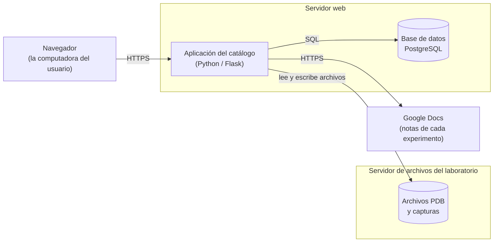
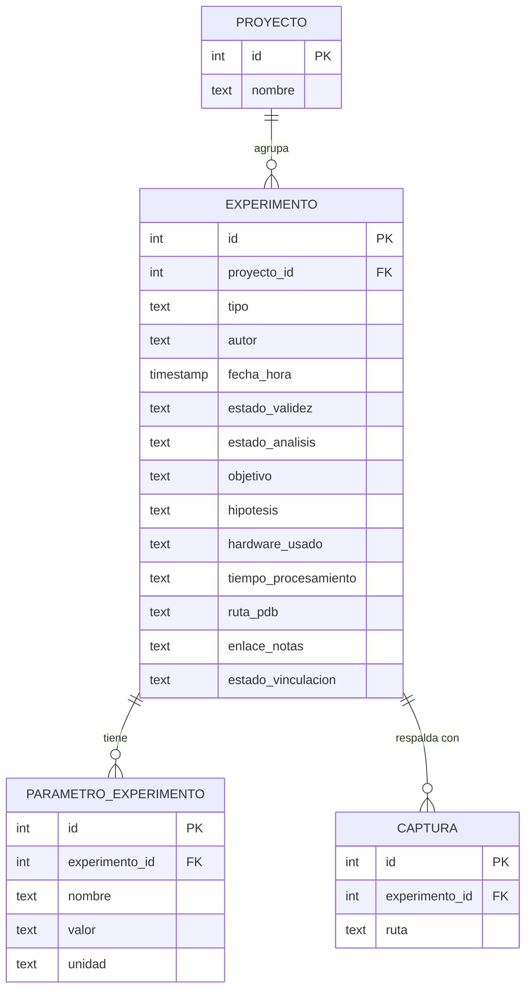
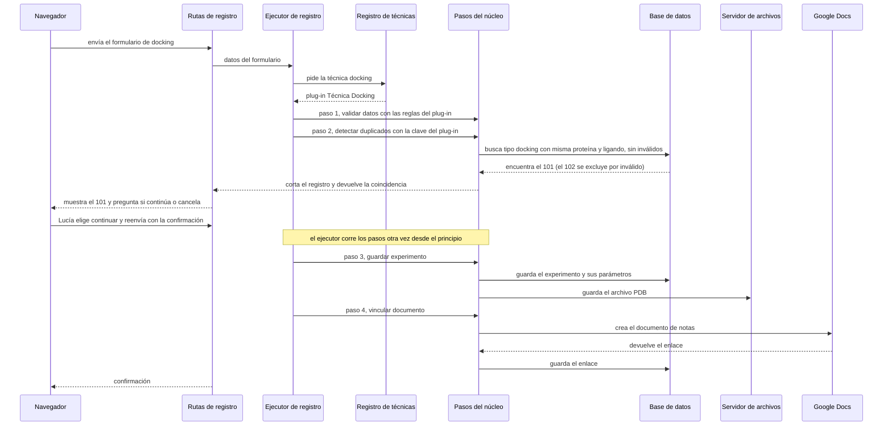

# Guía de estudio: cómo se ven la base de datos y los archivos de BitacoraBio 2026

> **Para qué sirve este archivo.** Es un apoyo para estudiar el documento de arquitectura (`arquitectura.md`). No es un entregable: los datos de ejemplo son inventados y los nombres de tablas y columnas son **ilustrativos**. El diseño final del esquema se decide al implementar (TP4).

---

## 0. La idea en tres frases

1. Lo que **tienen todos** los experimentos (autor, fecha, estado…) va en **columnas** de la tabla `experimento`.
2. Lo que **depende de la técnica** (en docking: proteína, ligando, software…) va en **filas** de la tabla `parametro_experimento`.
3. Los **archivos pesados** (PDB y capturas) **no** van en la base: viven en el servidor de archivos del laboratorio y la base guarda solo **dónde está** cada uno.

Todo lo demás del diseño (microkernel, plug-ins, índices) existe para que esas tres frases funcionen cuando entre una técnica nueva, como dinámica molecular.

---

## 1. Mapa general: dónde vive cada cosa



| Qué | Dónde vive | Por qué ahí |
|---|---|---|
| Datos del experimento y sus parámetros | Base de datos (servidor web) | Se consultan, filtran y comparan |
| Archivo PDB y capturas | Servidor de archivos del laboratorio | Son pesados: 100.000 PDB de ~250 KB son ~25 GB, y con todos los grupos llegan a terabytes (RT-08, DA-04) |
| Notas del experimento | Google Docs | Es un servicio externo (RT-06). Nuestra base guarda solo el **enlace** |
| Pantallas y visor 3D | Navegador | Muestra lo que le entrega la aplicación |

El navegador **nunca** habla directo con la base ni con el servidor de archivos: todo pasa por la aplicación.

---

## 2. La base de datos

### 2.1 Las tablas y cómo se relacionan



Leelo así: un **proyecto** agrupa muchos **experimentos**; cada experimento tiene **muchos parámetros** (filas) y **muchas capturas**.

> **Regla para decidir si algo es columna o parámetro:** si lo tendría *cualquier* técnica, es columna de `experimento`. Si solo tiene sentido en *una* técnica, es parámetro.

### 2.2 Ejemplo con datos: la tabla `proyecto`

| id | nombre |
|---|---|
| 1 | Inhibidores de proteasa |
| 2 | Estabilidad de enzimas |

### 2.3 Ejemplo con datos: la tabla `experimento`

La tabla es una sola; acá la partí en tres para que entre en pantalla.

**Identidad y estado**

| id | proyecto_id | tipo | autor | fecha_hora | estado_validez | estado_analisis |
|---|---|---|---|---|---|---|
| 101 | 1 | docking | Lucía Pérez | 2026-10-14 10:32 | finalizado | pendiente |
| 102 | 1 | docking | Martín Gómez | 2026-10-20 15:05 | **invalido** | pendiente |
| 103 | 1 | docking | Lucía Pérez | 2026-10-25 09:10 | en_curso | pendiente |
| 104 | 2 | dinamica_molecular | Martín Gómez | 2026-11-03 11:40 | en_curso | pendiente |

**Datos comunes a toda técnica**

| id | objetivo | hipotesis *(a confirmar, ver sección 8)* | hardware_usado | tiempo_procesamiento |
|---|---|---|---|---|
| 101 | Evaluar afinidad del ligando | El ligando ocupa el sitio activo | Servidor del lab, 16 núcleos | 2 h 10 min |
| 102 | Repetir con menos exhaustividad | Mismo resultado en menos tiempo | Servidor del lab, 16 núcleos | 35 min |
| 103 | Probar otro ligando | Menor afinidad que el ligando 101 | Servidor del lab, 16 núcleos | en curso |
| 104 | Medir estabilidad en agua | La proteína se mantiene estable | Clúster con GPU | en curso |

**Referencias (la base guarda dónde, no el contenido)**

| id | ruta_pdb | enlace_notas | estado_vinculacion |
|---|---|---|---|
| 101 | `pdb/101.pdb` | `docs.google.com/document/d/…` | vinculado |
| 102 | `pdb/102.pdb` | `docs.google.com/document/d/…` | vinculado |
| 103 | `pdb/103.pdb` | *(vacío)* | **no_vinculado** |
| 104 | *(vacío)* | *(vacío)* | no_vinculado |

Fijate que **no existe** una columna `proteina` ni `ligando`. Eso es lo importante.

### 2.4 Ejemplo con datos: la tabla `parametro_experimento`

Acá está lo propio de cada técnica. Cada fila es **un** dato de **un** experimento.

| id | experimento_id | nombre | valor | unidad |
|---|---|---|---|---|
| 1 | 101 | software | AutoDock Vina | *(vacía)* |
| 2 | 101 | proteina | Proteasa HIV-1 | *(vacía)* |
| 3 | 101 | ligando | Indinavir | *(vacía)* |
| 4 | 101 | sitio_activo | Asp25 | *(vacía)* |
| 5 | 101 | exhaustividad | 8 | *(vacía)* |
| 6 | 101 | caja_busqueda | 20x20x20 | Å |
| 7 | 102 | software | AutoDock Vina | *(vacía)* |
| 8 | 102 | proteina | Proteasa HIV-1 | *(vacía)* |
| 9 | 102 | ligando | Indinavir | *(vacía)* |
| 10 | 103 | proteina | Lisozima | *(vacía)* |
| 11 | 103 | ligando | NAG3 | *(vacía)* |
| … | … | … | … | … |
| 40 | 104 | software | GROMACS | *(vacía)* |
| 41 | 104 | sistema | Lisozima en agua | *(vacía)* |
| 42 | 104 | paso_tiempo | 2 | fs |
| 43 | 104 | duracion | 100 | ns |
| 44 | 104 | temperatura | 300 | K |

Cosas para notar:

- El experimento **104** (dinámica molecular) **no tiene ligando**, y la tabla no se quejó ni quedó una columna vacía. Eso es EC-07 funcionando.
- La **unidad** puede estar vacía (el "software" no tiene unidad). Se muestra en el detalle gracias a RF-12.
- El **valor** se guarda siempre como texto. Es un sacrificio declarado: la base no valida que "8" sea un número; lo valida el plug-in.

### 2.5 Los índices (para que sea rápido)

Un **índice** funciona como el índice de un libro: en vez de leer todas las filas, la base va directo a donde está lo que se busca.

| Índice sobre | Para qué sirve |
|---|---|
| `experimento(proyecto_id)`, `(fecha_hora)`, `(autor)`, `(tipo)` | Los filtros de RF-07: proyecto, fecha, autor |
| `parametro_experimento(experimento_id)` | Traer los parámetros de un experimento (el detalle) |
| `parametro_experimento(nombre, valor)` | Filtrar por proteína y buscar duplicados |

El orden de magnitud: 100.000 experimentos × ~10 parámetros ≈ **1.000.000 de filas**. Es una **estimación del grupo, no una medida**; por eso DA-05 pide medirlo con 100.000 experimentos de prueba.

---

## 3. Los archivos

### 3.1 Cómo se ve el servidor de archivos

```
Servidor de archivos del laboratorio
└── bitacorabio/
    ├── pdb/
    │   ├── 101.pdb        ← pose del experimento 101 (~250 KB)
    │   ├── 102.pdb
    │   └── 103.pdb
    └── capturas/
        ├── 1.png          ← captura del experimento 101
        ├── 2.png          ← otra captura del experimento 101
        └── 3.png          ← captura del experimento 103
```

- Hay **carpetas separadas** para PDB y capturas.
- El nombre del archivo es un **identificador** (`101.pdb`), **nunca** el nombre original que tenía en la computadora de quien lo subió.
- El navegador **no** accede a estas carpetas. Cuando el visor 3D necesita el PDB, se lo pide a la aplicación y ella se lo entrega.

### 3.2 Cómo se conectan base y archivos

```
 BASE DE DATOS                               SERVIDOR DE ARCHIVOS
┌──────────────────────────┐
│ experimento              │
│  id: 101                 │
│  ruta_pdb: pdb/101.pdb ──┼──────────────────▶  pdb/101.pdb
└──────────────────────────┘

┌──────────────────────────┐
│ captura                  │
│  id: 1                   │
│  experimento_id: 101     │
│  ruta: capturas/1.png ───┼──────────────────▶  capturas/1.png
└──────────────────────────┘
```

La base crece **solo con texto liviano** (datos y rutas). Los archivos pesados no la inflan, y los respaldos de la base siguen siendo manejables.

### 3.3 Qué pasa si algo falla

| Situación | Qué ocurre |
|---|---|
| Se cae el servidor de archivos | Se puede **listar y ver los datos**, pero no abrir PDB ni capturas. Un registro nuevo **falla y se revierte**, sin dejar un experimento a medias |
| Falla Google Docs | El experimento **queda guardado** y marcado `no_vinculado`; el reintento lo dispara el usuario desde el detalle (ejemplo: experimento 103) |
| Se corta la conexión mientras se guarda | Se revierte lo guardado: no queda un experimento a medias |

El orden de escritura es **primero el experimento, después el archivo**; si algo falla, se revierte lo hecho. Los respaldos de la base y de los archivos se coordinan para poder restaurar ambos al mismo momento.

---

## 4. Qué se ve en pantalla (y de dónde sale cada dato)

### 4.1 El formulario depende de la técnica

El formulario no está escrito "para docking": lo arma la aplicación con la **definición de parámetros** del plug-in de la técnica elegida.

```
 Técnica: [ docking ▼ ]                     Técnica: [ dinamica_molecular ▼ ]
 ─────────────────────────                  ─────────────────────────────────
 Proyecto            [ ........ ]           Proyecto            [ ........ ]
 Objetivo            [ ........ ]           Objetivo            [ ........ ]
 Proteína *          [ ........ ]           Sistema *           [ ........ ]
 Ligando *           [ ........ ]           Paso de tiempo *    [ .... ] fs
 Software *          [ ........ ]           Duración *          [ .... ] ns
 Sitio activo        [ ........ ]           Temperatura         [ .... ] K
 Exhaustividad       [ ........ ]           Software *          [ ........ ]
 Caja de búsqueda    [ ... ] Å              Archivo PDB         [ subir ]
 Archivo PDB *       [ subir ]
                                            (* = obligatorio, lo define el plug-in)
```

### 4.2 El listado

Trae las **columnas** que se muestran y solo los **parámetros de resumen** que define cada técnica (por eso la interfaz de técnica tiene ese cuarto elemento). No trae archivos ni el resto de los parámetros.

| Tipo | Resumen | Autor | Fecha | Estado |
|---|---|---|---|---|
| docking | Proteasa HIV-1 / Indinavir | Lucía Pérez | 14/10/2026 | finalizado |
| docking | Proteasa HIV-1 / Indinavir | Martín Gómez | 20/10/2026 | invalido |
| docking | Lisozima / NAG3 | Lucía Pérez | 25/10/2026 | en_curso |
| dinamica_molecular | Lisozima en agua | Martín Gómez | 03/11/2026 | en_curso |

*Tipo, autor, fecha y estado salen de columnas. El "Resumen" sale de los parámetros que el plug-in marcó como de resumen.*

### 4.3 El detalle de un experimento

```
┌─ Experimento 101 ─────────────────────────────────────────────┐
│ Tipo: docking            Proyecto: Inhibidores de proteasa     │   ← columnas
│ Autor: Lucía Pérez       Fecha: 14/10/2026 10:32               │
│ Validez: finalizado      Análisis: pendiente                   │
│ Objetivo: Evaluar afinidad del ligando                         │
│                                                                │
│ Parámetros                                                     │   ← filas, con unidad
│   software ........ AutoDock Vina                              │     (RF-12) y en el
│   proteina ........ Proteasa HIV-1                             │     orden que define
│   ligando ......... Indinavir                                  │     el plug-in
│   caja_busqueda ... 20x20x20 Å                                 │
│                                                                │
│ [ Ver pose 3D ]   [ Capturas (2) ]   [ Abrir documento de notas ]
└────────────────────────────────────────────────────────────────┘
   ↑ lee pdb/101.pdb      ↑ lee capturas/…     ↑ enlace guardado
```

---

## 5. Recorrido de un registro, con el ejemplo

Situación: Lucía registra un experimento de docking con **Proteasa HIV-1 + Indinavir**. Ya existen el 101 (finalizado) y el 102 (inválido) con esa misma combinación.



Qué mirar:

- El **Registro de técnicas** es quien conoce el plug-in. Los pasos no dicen "docking" en ningún lado: usan el plug-in que viene en la solicitud.
- La **coincidencia** del 101 se detecta, pero el **102 se excluye** porque está `invalido` (criterio de HU-01.B1.1).
- Si Lucía **cancela**, no se guarda nada ni se crea documento (HU-01.E3).
- Los pasos 1 y 2 **no escriben nada**; solo el paso 3 escribe.

---

## 6. Las consultas (ejemplos ilustrativos)

> Estas consultas son **solo para entender** la idea; no son código final.

**Filtro por autor** (RF-07): es una columna, así que es directo.

```sql
SELECT id, tipo, fecha_hora, estado_validez
FROM experimento
WHERE autor = 'Lucía Pérez';
```

**Filtro por proteína** (escenario EC-03): es un parámetro, así que hay que mirar la tabla de parámetros.

```sql
SELECT e.id, e.tipo, e.autor
FROM experimento e
JOIN parametro_experimento p ON p.experimento_id = e.id
WHERE p.nombre = 'proteina'
  AND p.valor  = 'Proteasa HIV-1';
```

**Búsqueda de duplicados**: mismo tipo, misma proteína **y** mismo ligando, sin los inválidos.

```sql
SELECT e.id
FROM experimento e
WHERE e.tipo = 'docking'
  AND e.estado_validez <> 'invalido'
  AND EXISTS (SELECT 1 FROM parametro_experimento p
              WHERE p.experimento_id = e.id
                AND p.nombre = 'proteina' AND p.valor = 'Proteasa HIV-1')
  AND EXISTS (SELECT 1 FROM parametro_experimento p
              WHERE p.experimento_id = e.id
                AND p.nombre = 'ligando'  AND p.valor = 'Indinavir');
```

**La diferencia que hay que entender:** filtrar por una columna es lo más rápido; filtrar por un parámetro exige unir dos tablas y es más lento, pero con el índice sobre `(nombre, valor)` debería entrar en los 5 segundos de EC-03. Es un **costo aceptado** a cambio de EC-07, y se **mide** (DA-05).

**Plan B** si no se cumpliera la medida: guardar en `experimento` una **clave de coincidencia derivada** de esos parámetros. Se descartó por ahora porque es un dato repetido que hay que mantener sincronizado.

---

## 7. Agregar dinámica molecular (el escenario EC-07)

El experimento 104 de los ejemplos ya es de dinámica molecular. Mirá qué hay que tocar y qué no:

| | ¿Se toca? | Detalle |
|---|---|---|
| Tabla `experimento` | **No** | Ninguna columna nueva (medida de EC-07 del TP2) |
| Tabla `parametro_experimento` | **No** (el esquema) | Solo se agregan **filas**: paso_tiempo, duracion, temperatura… |
| Núcleo del registro | **No** | Ejecutor, Registro de técnicas y los cuatro pasos quedan igual (medida propia de la arquitectura) |
| Plug-in Técnica Docking | **No** | Sigue funcionando igual |
| **Plug-in Técnica Dinámica molecular** | **Sí, es nuevo** | Un módulo que declara: parámetros (nombre, unidad, obligatorio, formato), validaciones propias, clave de coincidencia y parámetros de resumen |
| Registro de técnicas | Una línea | Se registra el plug-in nuevo al arrancar |

Qué entrega el plug-in nuevo (ejemplo):

| Qué entrega | Ejemplo para dinámica molecular |
|---|---|
| Definición de parámetros | sistema (obligatorio), paso_tiempo (fs), duracion (ns), temperatura (K), software |
| Validaciones propias | La duración debe ser mayor que el paso de tiempo |
| Clave de coincidencia | Qué parámetros hacen que dos simulaciones sean duplicadas (a definir: por ejemplo, el sistema) |
| Parámetros de resumen | sistema, duracion |

**Riesgo declarado en DA-02:** la interfaz de técnica se diseñó con **un solo ejemplo** (docking). Si dinámica molecular necesita algo que la interfaz no prevé, hay que ampliarla y eso sí toca el núcleo. Por eso la verificación de DA-02 propone implementar dinámica molecular como plug-in de prueba.

---

## 8. Pendiente: la hipótesis

El RF-01 pide el campo **hipótesis**, pero el modelo de dominio del SRS no se la asigna a `experimento`. En esta guía la puse como **columna común** (toda técnica tiene una hipótesis). Es una decisión **a confirmar**:

| Opción | Ventaja | Costo |
|---|---|---|
| Columna común | Simple; toda técnica la tiene | Si algún día hubiera una técnica sin hipótesis, queda vacía |
| Parámetro | Nunca obliga a tocar el esquema | Un texto largo guardado como fila; menos natural en el detalle |

No bloquea nada de la arquitectura. Conviene decidirlo **antes de cargar datos reales**, porque moverla después es una migración.

---

## 9. Preguntas de repaso (con respuesta)

1. **¿Por qué molécula y ligando no son columnas?**
   Son datos del docking. Con columnas, una técnica sin ligando dejaría la columna vacía y otra con otras entidades clave pediría columnas nuevas, contra el espíritu de EC-07 y contra el modelo de dominio del SRS.

2. **¿Qué guarda la base de un archivo PDB?**
   Solo su **ruta**. El archivo vive en el servidor de archivos del laboratorio (RT-05, RT-08, DA-04).

3. **¿Dónde está el contenido de las notas?**
   En Google Docs. La base guarda el enlace y el estado de vinculación.

4. **¿Qué se mide para decir que EC-07 se cumple?**
   Que agregar dinámica molecular no cambie ninguna columna existente y se haga en menos de una jornada (TP2), y que no se modifique ningún componente del núcleo (medida propia, DA-02).

5. **¿Qué es un plug-in de técnica y qué entrega?**
   Un componente que declara lo propio de una técnica: definición de parámetros, validaciones propias, clave de coincidencia y parámetros de resumen.

6. **¿Qué sacrifica elegir parámetros en vez de columnas?**
   Filtrar por parámetro es más lento y el valor se guarda como texto, sin tipo a nivel de esquema.

7. **¿Cómo se controla ese sacrificio?**
   Con un índice sobre `(nombre, valor)`, midiendo con 100.000 experimentos (DA-05), y con la clave derivada como plan B.

8. **¿Por qué el listado no trae todos los parámetros?**
   Para ser liviano (EC-03): trae las columnas visibles y solo los parámetros de resumen. El detalle completo se pide al abrir un experimento.

9. **¿Qué pasa si falla Google Docs?**
   El experimento queda guardado como `no_vinculado`, sin pérdida de datos (EC-05), y el reintento lo dispara el usuario (RF-09, EC-06).

10. **¿Qué pasa si se cae el servidor de archivos?**
    Se puede listar y ver los datos, pero no abrir PDB ni capturas, y un registro nuevo se revierte sin dejar nada a medias.

11. **¿Por qué el núcleo "no funciona sin plug-ins" y eso es un problema para la Tabla 4?**
    La Tabla 4 dice que el núcleo debe funcionar con lo mínimo sin plug-ins. El nuestro no puede validar ni buscar duplicados sin saber la técnica. Lo declaramos como **variante** (5.2.2 y DA-02): Técnica Docking es obligatoria en la primera versión.

---

## 10. Para ubicar cada tema en `arquitectura.md`

| Tema | Dónde está |
|---|---|
| Por qué EC-07 es el driver principal | Sección 4.2 |
| Tácticas del microkernel | Sección 5.1 (EC-07) |
| Microkernel y su variante | Sección 5.2.2 |
| Conflicto parámetros contra desempeño | Sección 5.6 |
| Núcleo y plug-ins en componentes | Sección 7 |
| Decisión del microkernel | DA-02 |
| Decisión de parámetros como filas | DA-03 |
| Archivos fuera de la base | DA-04 |
| Índices y listados livianos | DA-05 |
| Despliegue y servidor de archivos | Sección 8 y DA-07 |
